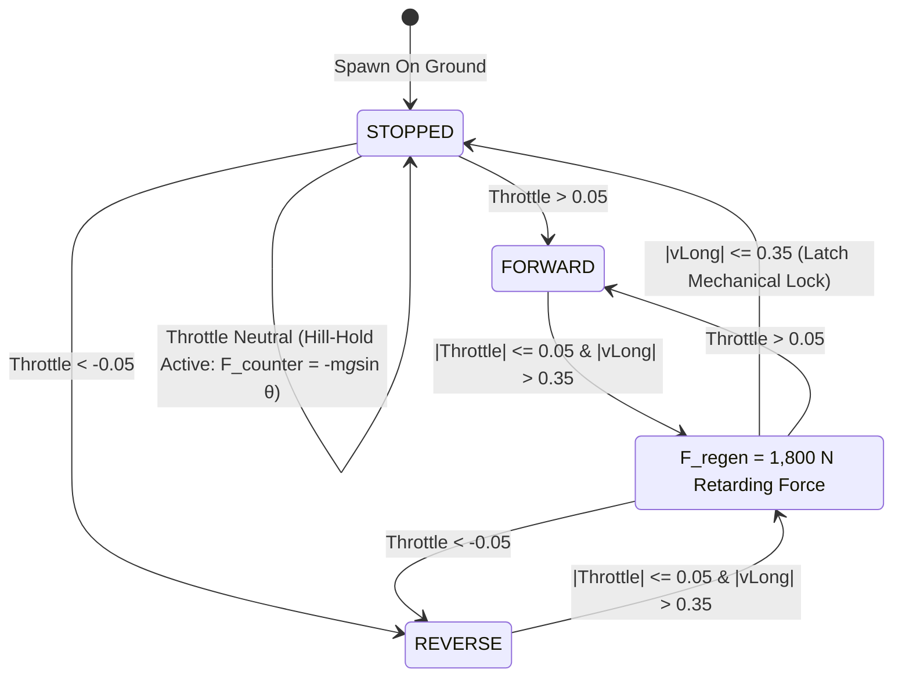
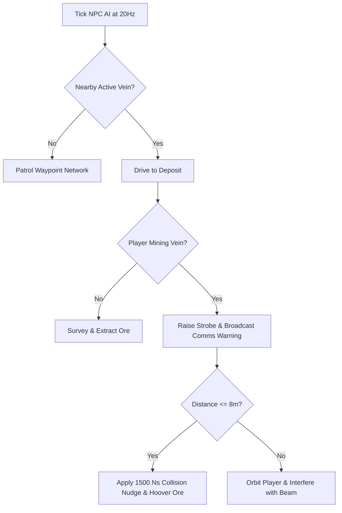
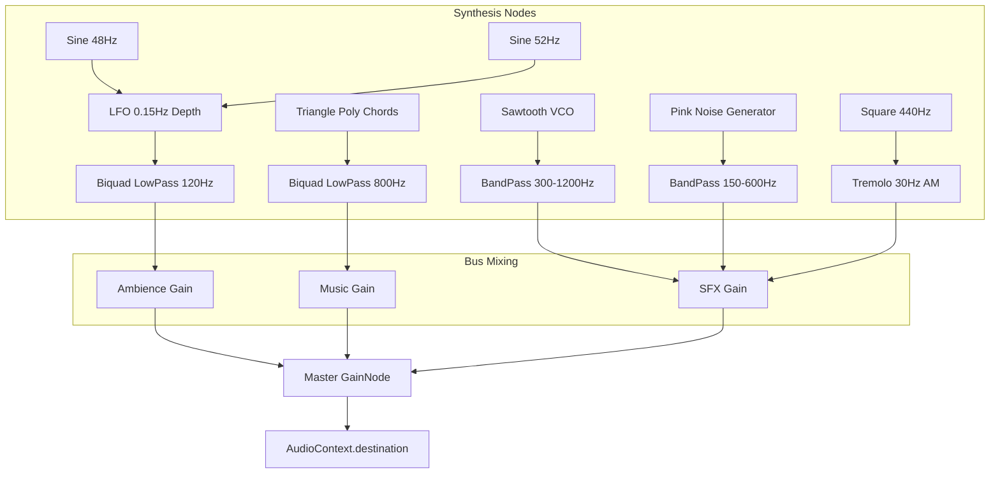

# Architectural Blueprint: Spec 25 — Misc General Cleanup & Frontier World Expansion

> **Companion Spec:** `specs/25-lunar-frontier-misc-general-cleanup.md`  
> **Target Subsystems:** `games/lunar-frontier/src/engine/WorldScene.ts`, `games/lunar-frontier/src/infrastructure/RailSystem.ts`, `games/lunar-frontier/src/physics/TraversalPhysics.ts`, `games/lunar-frontier/src/client/ClientApp.ts`, `games/lunar-frontier/src/entities/NPCProspectorBot.ts` (new), `games/lunar-frontier/src/infrastructure/RivalBases.ts` (new), `games/lunar-frontier/src/audio/LunarAudioSystem.ts` (new), `games/lunar-frontier/src/ui/LunarHUD.ts`.

---

## 1. Architectural Overview & Component Topology

Spec 25 addresses five operational layers across the client, physics, world generation, and audio pipelines:

1. **Horizon Skirt & Ground Anchor Layer (`WorldScene.ts`, `RailSystem.ts`):** Extends visible ground to a 12 km planetary radius, elevates minimum ambient regolith luminance ($L^* \ge 18\%$), and anchors all rail lines with ballast berm geometry.
2. **Powertrain Stability & Hill-Hold Layer (`TraversalPhysics.ts`, `ClientApp.ts`):** Provides $1,800\,\text{N}$ automatic regenerative coast deceleration, rigid mechanical slope-gravity cancellation at standstill, and gamepad channel decoupling.
3. **Autonomous Competitor Layer (`NPCProspectorBot.ts`):** Kinematic roving NPC bots governed by behavior trees with waving fictional flags, ore detection, and mining disruption/shoving logic.
4. **Rival Infrastructure Layer (`RivalBases.ts`, `Factions.ts`):** Three distinct dilapidated architectural archetypes (Scrappers, Corporate Enclave, Nomad Rig) laying the foundation for Clash-of-Clans territory warfare.
5. **Procedural Audio Layer (`LunarAudioSystem.ts`):** Zero-asset Web Audio API synthesis engine driving ambient suit life-support drone, generative sci-fi music, motor whine, and contact sound effects.

```
┌────────────────────────────────────────────────────────────────────────────────────────┐
│                                       ClientApp                                        │
│                                                                                        │
│   ┌─────────────────────┐   ┌───────────────────────┐   ┌──────────────────────────┐   │
│   │     WorldScene      │   │   TraversalPhysics    │   │     LunarAudioSystem     │   │
│   │                     │   │                       │   │                          │   │
│   │ • 12km Crust Skirt  │   │ • 1,800N Regen Decel  │   │ • Web Audio API Bus      │   │
│   │ • Visor Floor >=0.16│   │ • Mechanical Hill-Hold│   │ • Sub-Bass Suit Drone    │   │
│   │ • Rail Ballast Berm │   │ • Slope Counter-Torque│   │ • Generative Synth Pad   │   │
│   │ • Regolith PBR      │   │ • Stick Decoupling    │   │ • Powertrain/Mining SFX  │   │
│   └──────────┬──────────┘   └───────────┬───────────┘   └────────────┬─────────────┘   │
│              │                          │                            │                 │
│              ▼                          ▼                            ▼                 │
│   ┌─────────────────────┐   ┌───────────────────────┐   ┌──────────────────────────┐   │
│   │     RivalBases      │   │   NPCProspectorBot    │   │         LunarHUD         │   │
│   │                     │   │                       │   │                          │   │
│   │ • Scrapper Redoubt  │   │ • AI State Machine    │   │ • Audio Volume Sliders   │   │
│   │ • Corp Enclave      │   │ • Waving Cloth Flags  │   │ • Territory Warning HUD  │   │
│   │ • Nomad Mobile Rig  │   │ • Proximity Harassment│   │ • Comms Audio Indicators │   │
│   │ • Decayed Meshes    │   │ • Nudge Impulses      │   │ • Speed/Slope Telemetry  │   │
│   └─────────────────────┘   └───────────────────────┘   └──────────────────────────┘   │
└────────────────────────────────────────────────────────────────────────────────────────┘
```

---

## 2. Subsystem Event Flows & Mechanics

### 2.1 Terrain Skirt & Ballast Integration
```mermaid
sequenceDiagram
    autonumber
    participant WS as WorldScene
    participant WG as LunarWorldGenerator
    participant RS as RailSystem
    participant Cam as CameraRig

    WS->>WG: generate() -> WorldSnapshot
    WS->>WS: buildTerrain() [Central 1024m Patch]
    WS->>WS: buildTerrainSkirt() [12km Radial Ring Lattice]
    loop For each skirt vertex (wx, wy)
        WS->>WG: elevationAt(wx, wy)
        WS->>WS: applyCurvature(R_moon = 1737.4km)
    end
    WS->>RS: load(snapshot)
    loop For each rail track point (x, y)
        RS->>WG: elevationAt(x, y)
        RS->>RS: buildBallastBerm() if gap > 0
    end
    Cam->>WS: Render Frame
    Note over WS,Cam: Horizon extends seamlessly to lunar curve; zero black voids.
```

### 2.2 Powertrain Hill-Hold State Machine


### 2.3 NPC Prospector Bot Behavior Tree & Harassment Loop


### 2.4 Procedural Web Audio Synthesis Topology


---

## 3. Data Contracts & Module Manifest

| Subsystem | Source Path | Key Responsibilities |
| :--- | :--- | :--- |
| **Terrain & Horizon** | `src/engine/WorldScene.ts` | 12 km outer crust skirt mesh, elevated minimum visor emissive floor ($\ge 0.16$), Hapke opposition surge lighting balance. |
| **Rail Grounding** | `src/infrastructure/RailSystem.ts` | Rail elevation clamping to terrain, ballast embankment berm geometry, zero floating tracks. |
| **Powertrain Physics** | `src/physics/TraversalPhysics.ts` | $1,800\,\text{N}$ neutral regenerative deceleration, active mechanical hill-hold slope gravity cancellation ($0.00\,\text{m/s}$ drift up to $35^\circ$). |
| **Input Pipeline** | `src/client/ClientApp.ts` | Gamepad deadband filtering ($0.15$), decoupled steering and camera yaw, safe trigger rail initialization. |
| **NPC Prospectors** | `src/entities/NPCProspectorBot.ts` | Kinematic rover physics, waving flag mesh, AI behavior tree (`patrol`, `survey`, `contest`, `harass`, `nudge`). |
| **Rival Bases** | `src/infrastructure/RivalBases.ts` | Three decayed base archetypes (Scrappers, Corporate, Nomad), territory radii, cracked dome meshes, turret sockets. |
| **Audio Synthesizer** | `src/audio/LunarAudioSystem.ts` | Pure Web Audio API procedural synthesis, suit life-support drone, space synth music, motor/mining SFX, HUD audio mixer. |

---

## 4. Verification Harness & Acceptance Gate

The verification suite `scripts/smoke-general-cleanup.ts` will run in headless CI under `NullEngine` and validate:
1. **Terrain Skirt Geometry:** Verifies skirt vertex count, 12,000m radial reach, and elevation matching with `LunarWorldGenerator`.
2. **Hill-Hold Physics Zero Drift:** Asserts that on $15^\circ$ and $25^\circ$ lunar slopes, a buggy releasing throttle reaches $v = 0.00\,\text{m/s}$ within $\le 4.5\,\text{s}$ and exhibits zero displacement drift over 60 seconds of simulation.
3. **Input Channel Decoupling:** Verifies that camera look-stick commands (`axes[2]`, `axes[3]`) and resting triggers (`axes[4]`, `axes[5]`) produce zero vehicle steering or forward acceleration.
4. **NPC State Machine & Flag Geometry:** Asserts NPC state transitions under simulated player proximity, flag flutter mesh vertex bindings, and collision impulse generation.
5. **Rival Base Spawns & Degradation:** Verifies 3 rival outposts spawned at valid terrain nodes with correct decay metrics, turret sockets, and bounding radii.
6. **Web Audio Synthesizer Node Topology:** Asserts mock AudioContext node graph construction, gain routing, volume parameter clamping, and clean disposal without memory leaks.
