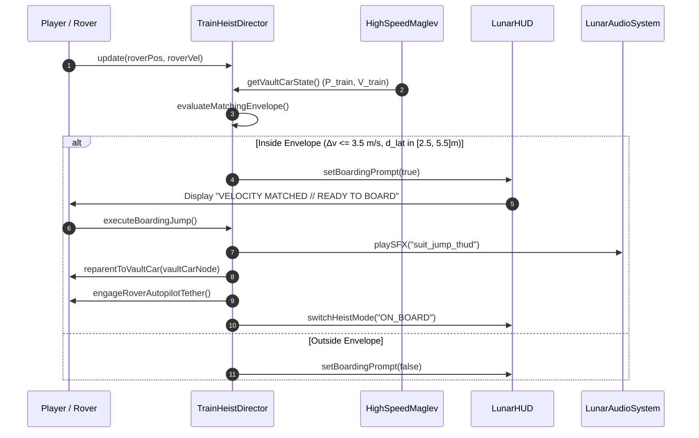

# Architectural Blueprint: Spec 26 — X-Corp Citadel Monolith, High-Speed Maglev Rail Hub & The Great Train Heist

> **Companion Spec:** `specs/26-x-corp-citadel-and-rail-heist.md`  
> **Target Subsystems:** `games/lunar-frontier/src/infrastructure/XCorpCitadel.ts` (new), `games/lunar-frontier/src/infrastructure/HighSpeedMaglev.ts` (new), `games/lunar-frontier/src/quests/TrainHeistDirector.ts` (new), `games/lunar-frontier/src/engine/WorldScene.ts`, `games/lunar-frontier/src/client/ClientApp.ts`, `games/lunar-frontier/src/quests/QuestEngine.ts`, `games/lunar-frontier/src/ui/LunarHUD.ts`, `games/lunar-frontier/src/audio/LunarAudioSystem.ts`.

---

## 1. Architectural Overview & Component Topology

Spec 26 introduces the corporate antagonist faction **X-Corp**, its impenetrable surface fortress **The Citadel ("The Obsidian Apex")**, a dedicated $3,500\,\text{m}$ elevated linear induction maglev rail system carrying the high-speed **Apex Express ("The Gilded Serpent")**, and the core narrative heist gameplay loop (**"Operation Gilded Serpent"**).

```
┌────────────────────────────────────────────────────────────────────────────────────────┐
│                                       ClientApp                                        │
│                                                                                        │
│   ┌─────────────────────┐   ┌───────────────────────┐   ┌──────────────────────────┐   │
│   │     WorldScene      │   │   TrainHeistDirector  │   │       QuestEngine        │   │
│   │                     │   │                       │   │                          │   │
│   │ • Babylon.js Scene  │   │ • Velocity Match Loop │   │ • Stage Machine          │   │
│   │ • Skybox & Lighting │   │ • Relative Parenting  │   │ • Comms Audio Dialog     │   │
│   │ • Surface Terrain   │   │ • Autopilot Tether    │   │ • Faction Reputations    │   │
│   │ • Camera Controller │   │ • Depot Countdown     │   │ • Contraband Economy     │   │
│   └──────────┬──────────┘   └───────────┬───────────┘   └────────────┬─────────────┘   │
│              │                          │                            │                 │
│              ▼                          ▼                            ▼                 │
│   ┌─────────────────────┐   ┌───────────────────────┐   ┌──────────────────────────┐   │
│   │     XCorpCitadel    │   │    HighSpeedMaglev    │   │    LunarHUD & Audio      │   │
│   │                     │   │                       │   │                          │   │
│   │ • Obsidian Monolith │   │ • 3.5km Guideway Pylons│  │ • Intercept Radar & Bar  │   │
│   │ • Kinetic Shield FX │   │ • Linear Stator Coils │   │ • 45s Countdown Meter    │   │
│   │ • CIWS Laser Sentry │   │ • 4-Car Maglev Consist│   │ • Mag-Lock Decrypt UI    │   │
│   │ • Blast Gate Tunnel │   │ • Spline Kinematics   │   │ • Induction Hum / SFX    │   │
│   └─────────────────────┘   └───────────────────────┘   └──────────────────────────┘   │
└────────────────────────────────────────────────────────────────────────────────────────┘
```

---

## 2. Subsystem Event Flows & Mechanics

### 2.1 The Intercept, Boarding & Heist State Machine
```mermaid
stateDiagram-v2
    [*] --> INACTIVE
    INACTIVE --> INTERCEPTING : Quest "Operation Gilded Serpent" Initiated
    
    INTERCEPTING --> VELOCITY_MATCHED : Δv <= 3.5 m/s && d_lateral in [2.5, 5.5]m
    VELOCITY_MATCHED --> INTERCEPTING : Rover Falls Out of Envelope
    
    VELOCITY_MATCHED --> ON_BOARD_CATWALK : Action Key [E] / Gamepad (X)
    Note over ON_BOARD_CATWALK: Player parented to Vault Car local frame;\nRover enters parallel autopilot tether mode.

    ON_BOARD_CATWALK --> CRACKING_VAULT : Interact with Cyber-Lock Terminal
    CRACKING_VAULT --> LOOT_SECURED : Hack Timer Complete (6.0s)

    LOOT_SECURED --> DEPOT_COUNTDOWN : Alarm Triggers (T-45.0s to Depot Entry)
    
    DEPOT_COUNTDOWN --> BAILOUT_SUCCESS : Leap Off Deck (Space / Gamepad A)
    DEPOT_COUNTDOWN --> FAILED_VAPORIZED : Countdown Hits 0:00 (Shield Barrier Contact)

    BAILOUT_SUCCESS --> ESCAPE_COMPLETE : Mount Tethered Rover & Reach Fence (RustBelt)
    ESCAPE_COMPLETE --> [*]
```

### 2.2 Sequence Diagram: High-Speed Intercept & Boarding


---

## 3. Mathematical & Kinematic Formulations

### 3.1 Relative Platform Coordinate Transformation
When the player is on foot aboard the speeding train car, applying world physics directly leads to numerical drift and instantaneous relative sliding at $25\,\text{m/s}$. To achieve rock-solid physics in Babylon.js:

1. **Local Space Transform:**
   The player avatar's position and orientation are anchored to the Vault Car's local coordinate frame:
   $$\vec{P}_\text{world}(t) = \mathbf{M}_\text{vault}(t) \cdot \vec{P}_\text{local}(t)$$
   where $\mathbf{M}_\text{vault}(t) = \mathbf{T}(\vec{P}_\text{car}(t)) \cdot \mathbf{R}(\mathbf{q}_\text{car}(t))$ is the world matrix of the car root node.

2. **Decoupled Kinematics:**
   Avatar movement inputs (walk, sprint, jump) apply relative displacements in the car's local coordinate frame:
   $$\vec{P}_\text{local}(t + \Delta t) = \vec{P}_\text{local}(t) + \mathbf{R}_\text{yaw}(\theta_\text{cam}) \cdot \vec{v}_\text{input} \cdot \Delta t$$
   Lunar gravity ($g = 1.62\,\text{m/s}^2$) operates along the local vertical axis $\hat{Y}_\text{local}$ of the car deck.

### 3.2 Velocity Matching & Interception Envelope
The mathematical criteria for enabling the high-speed boarding trigger:
$$\Delta v = \left\| \vec{v}_\text{rover} - \vec{v}_\text{train} \right\| \le 3.5\,\text{m/s}$$

$$d_\text{lateral} = \left\| \vec{r}_\text{rel} - (\vec{r}_\text{rel} \cdot \hat{T}_\text{train}) \hat{T}_\text{train} \right\| \in [2.5\,\text{m},\; 5.5\,\text{m}]$$

$$d_\text{longitudinal} = \left| \vec{r}_\text{rel} \cdot \hat{T}_\text{train} \right| \le 3.0\,\text{m}$$

where $\vec{r}_\text{rel} = \vec{P}_\text{rover} - \vec{P}_\text{vault}$ and $\hat{T}_\text{train}$ is the unit forward tangent of the guideway.

### 3.3 Citadel Defense Forcefield Potential Field
The Citadel perimeter barrier enforces physical impenetrability using a soft-clamp radial repulsive forcefield:
$$F_\text{repulsion}(r) = \begin{cases} 
0 & \text{if } r > R_\text{shield} \\
-k_\text{shield} \cdot (R_\text{shield} - r)^2 \cdot \hat{r} & \text{if } R_\text{lethal} < r \le R_\text{shield} \\
\infty \text{ (Destruction Strike)} & \text{if } r \le R_\text{lethal}
\end{cases}$$
where $R_\text{shield} = 220\,\text{m}$, $R_\text{lethal} = 180\,\text{m}$, and $k_\text{shield} = 45.0\,\text{N/m}^2$.

---

## 4. Verification Architecture & Test Gates

The subsystem is validated headlessly via `games/lunar-frontier/scripts/smoke-x-corp-heist.ts` on `NullEngine`:

1. **Citadel Geometry & Defense Bounds (25 assertions):**
   - Validates procedural mesh generation of Monolith, Penthouse, and Laser Spires.
   - Asserts perimeter potential field forces at $r = 300\,\text{m}$ (zero), $r = 200\,\text{m}$ ($F > 1,500\,\text{N}$ outward), and $r \le 180\,\text{m}$ (lethal strike).
2. **High-Speed Maglev Guideway & Kinematics (30 assertions):**
   - Asserts continuous $3,500\,\text{m}$ Catmull-Rom spline arc-length evaluation.
   - Verifies 4-car consist spacing ($L_\text{car} = 14\,\text{m}$), forward orientation alignment, and steady-state velocity ($25.0\,\text{m/s}$).
3. **Train Heist Director & Platform Physics (35 assertions):**
   - Verifies velocity-matching trigger logic with tolerance fuzzing.
   - Verifies relative coordinate matrix transforms and zero relative slippage on deck.
   - Verifies vault hacking timer, loot generation, and 45s countdown trigger.
4. **Bailout Kinematics & Extraction (20 assertions):**
   - Verifies ballistic launch impulse and safe landing envelope outside the Citadel lethal threshold.

---

## 5. 💡 Note to Future Self: Hosting Portability

- **Client/Server Decoupling:** The X-Corp Citadel collision geometry, barrier potential field equations, and high-speed maglev spline evaluations run on deterministic client-side mathematics (`NullEngine`-compatible). When migrating to full authoritative multiplayer sync on `LunarServer.ts`, train position $s(t)$ and vault state are easily driven via a single scalar timestamp $t_\text{server}$ replicated across WebSocket frames without high-bandwidth mesh replication.
- **Platform Agnostic Rendering:** Procedural shaders and meshes use standard Babylon.js PBR materials and fall back cleanly under WebGL2 or headless `NullEngine` environments without vendor-specific WebGPU extensions.

