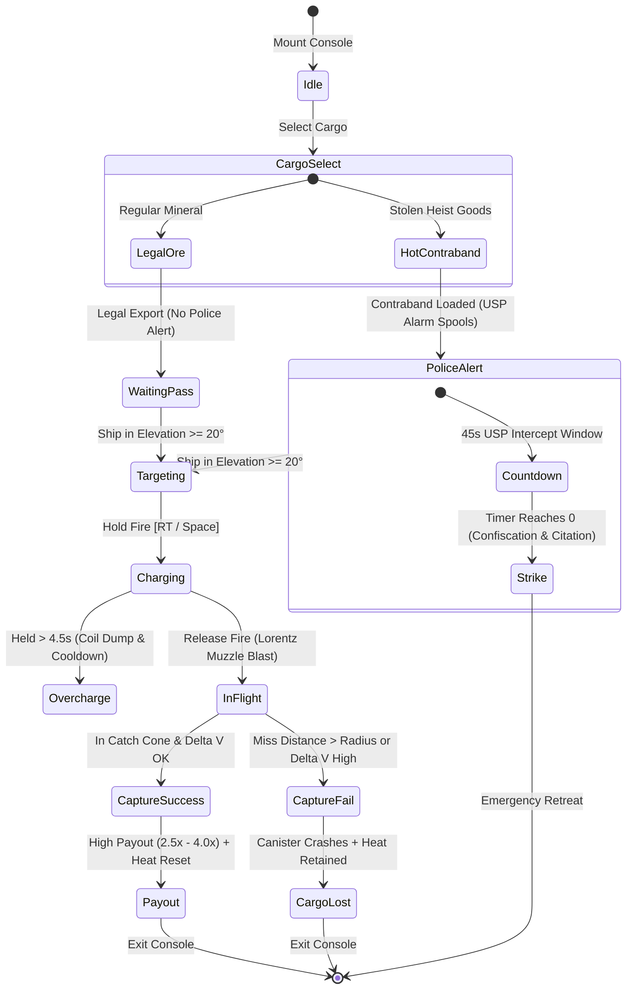

# Architecture Blueprint: 27 — Lunar Frontier Orbital Mass Accelerator & Contraband Export Minigame

## System Overview & Component Hierarchy

Spec 27 introduces a high-skill, physically simulated ballistic minigame to *Lunar Frontier*. Players operate the **Mare Mass Accelerator ("The Gauss Needle")**—a $180\,\text{m}$ elevated linear induction coilgun—to launch payload canisters containing mined minerals or stolen contraband off the lunar surface to be magnetically intercepted by passing orbital freighters bound for Earth-Moon Lagrange transfer hubs.

```
+---------------------------------------------------------------------------------------------------+
|                                        WORLD & SCENE LAYER                                        |
|  +-------------------------------------+                +--------------------------------------+  |
|  |        MassAccelerator.ts           |                |      OrbitalTransportSystem.ts       |  |
|  | - 180m Linear Induction Gantry      |                | - Keplerian Orbital Transit Engine   |  |
|  | - Traversing Ring Base (40m dia)    |                | - Bulk Freighters (CisLunar Horizon) |  |
|  | - Hydraulic Trunnions (2-axis)      |                | - Syndicate Runners (Obsidian Slip)  |  |
|  | - 24 Superconducting Coils (HTS)   |                | - USP Patrol Cutters (Vigilance)     |  |
|  | - Cryo-Capacitor Bank Sub-Station  |                | - Electromagnetic Capture Cones      |  |
|  +-------------------------------------+                +--------------------------------------+  |
+---------------------------------------------------------------------------------------------------+
                                                  │
                                                  ▼
+---------------------------------------------------------------------------------------------------+
|                                    PHYSICS & BALLISTICS LAYER                                     |
|  +---------------------------------------------------------------------------------------------+  |
|  |                             BallisticTrajectoryEngine.ts                                    |  |
|  | - Vacuum Lunar Ballistics (g = 1.62 m/s², Cd = 0)                                            |  |
|  | - Closed-Form Interception Minimizer (tau_intercept, d_min)                                 |  |
|  | - Dynamic 60 Hz Predictive Lead Reticle ("Ghost Target")                                    |  |
|  | - Magnetic Gradient Capture Funnel (F_mag = -k_mag / r² * r_hat)                             |  |
|  +---------------------------------------------------------------------------------------------+  |
+---------------------------------------------------------------------------------------------------+
                                                  │
                                                  ▼
+---------------------------------------------------------------------------------------------------+
|                                  GAMEPLAY & LIFECYCLE LAYER                                       |
|  +---------------------------------------------------------------------------------------------+  |
|  |                              ExportMinigameDirector.ts                                      |  |
|  | - Gunner Cupola Interaction State Machine                                                  |  |
|  | - Cargo Allocation (Mined Ore vs. Stolen Heist Contraband)                                  |  |
|  | - Capacitor Spooling & Overcharge Safety Breaker                                            |  |
|  | - 45-Second United Space Police (USP) Intercept Threat & Confiscation Engine                |  |
|  | - Market Payout Multipliers (2.5x - 4.0x) & Off-World Contraband Laundering                  |  |
|  +---------------------------------------------------------------------------------------------+  |
+---------------------------------------------------------------------------------------------------+
                                                  │
                                                  ▼
+---------------------------------------------------------------------------------------------------+
|                                   PRESENTATION & AUDIO LAYER                                      |
|  +-------------------------------------+                +--------------------------------------+  |
|  |             LunarHUD.ts             |                |          LunarAudioSystem.ts         |  |
|  | - Ballistic Vector Crosshair        |                | - Ramping Capacitor Spool Whine      |  |
|  | - Predictive Lead Diamond Pip       |                | - Supersonic Lorentz Discharge Crack |  |
|  | - Sky-Track Orbital Radar           |                | - Doppler Canister Vacuum Hiss       |  |
|  | - Segmented Velocity Muzzle Gauge   |                | - Resonant Magnetic Capture Chime    |  |
|  | - Flashing USP Radar Alert Widget   |                | - Alternating Klaxon Alert Siren     |  |
|  +-------------------------------------+                +--------------------------------------+  |
+---------------------------------------------------------------------------------------------------+
```

---

## Kinematics, Trajectory & Capture Math

### 1. Lunar Vacuum Ballistic Arc
In lunar vacuum, horizontal drag is identically zero ($C_d = 0$), and vertical acceleration is constant ($\vec{g} = [0, -1.62, 0]^\top$).
Given muzzle position $\vec{r}_0$ and launch velocity $\vec{v}_0$:

$$\vec{r}(t) = \vec{r}_0 + \vec{v}_0 t + \frac{1}{2} \vec{g} t^2$$

$$\vec{v}(t) = \vec{v}_0 + \vec{g} t$$

Muzzle velocity $\vec{v}_0$ is parameterized by barrel elevation $\theta \in [15^\circ, 85^\circ]$, azimuth $\psi \in [0^\circ, 360^\circ]$, and launch speed $v_0 \in [180, 420]\,\text{m/s}$:

$$\vec{v}_0 = v_0 \cdot \begin{pmatrix} \cos\theta \cos\psi \\ \sin\theta \\ \cos\theta \sin\psi \end{pmatrix}$$

### 2. Relative Target Vector & Lead Minimization
The passing orbital transport moves at velocity $\vec{v}_T$ across altitude $H$:

$$\vec{r}_T(t) = \vec{r}_{T0} + \vec{v}_T t$$

The relative separation vector $\vec{D}(t) = \vec{r}(t) - \vec{r}_T(t)$ is quadratic in flight time $t$:

$$\vec{D}(t) = \vec{\Delta r}_0 + \vec{\Delta v}_0 t + \frac{1}{2}\vec{g}t^2$$

Where $\vec{\Delta r}_0 = \vec{r}_0 - \vec{r}_{T0}$ and $\vec{\Delta v}_0 = \vec{v}_0 - \vec{v}_T$.

The lead calculator finds the optimal launch velocity vector $\vec{v}_0^*$ such that at the time of closest approach $\tau^*$, $\|\vec{D}(\tau^*)\| \le R_\text{catch}$ and relative speed $\|\vec{v}(\tau^*) - \vec{v}_T\| \le v_\text{max\_capture}$.

### 3. Capacitor Energy & Spool Dynamics
Capacitor voltage builds non-linearly according to an RC charging profile:

$$v_0(t_\text{charge}) = v_\text{min} + (v_\text{max} - v_\text{min}) \left(1 - e^{-t_\text{charge}/\tau_\text{spool}}\right)$$

Where $v_\text{min} = 180\,\text{m/s}$, $v_\text{max} = 420\,\text{m/s}$, and $\tau_\text{spool} = 1.6\,\text{s}$. If held beyond $t_\text{trip} = 4.5\,\text{s}$, thermal breaker activates, venting capacitors into heat sinks for a $5.0\,\text{s}$ penalty.

---

## Contraband Laundering & United Space Police State Flow



---

## Module Boundaries & Integration Hooks

1. **`games/lunar-frontier/src/infrastructure/MassAccelerator.ts`:**
   - Procedural Babylon.js mesh assembly (ring foundation, trunnions, 180m hexagonal truss barrel, 24 HTS coils, capacitor banks).
   - Independent 2-axis articulation with slew rates: $\omega_\text{azimuth} = 25^\circ/\text{s}$, $\omega_\text{elevation} = 15^\circ/\text{s}$.
   - Positioned on caldera rim $(X = -320\,\text{m}, Y = -1,450\,\text{m})$.
2. **`games/lunar-frontier/src/infrastructure/OrbitalTransportSystem.ts`:**
   - Transit generator scheduling passing freighters every $90\text{--}120\,\text{s}$ at altitudes $1,200\text{--}2,200\,\text{m}$.
   - Procedural vessels (*CisLunar Horizon*, *The Obsidian Slip*, *USP Vigilance*).
   - Dynamic conical capture volumes.
3. **`games/lunar-frontier/src/physics/BallisticTrajectoryEngine.ts`:**
   - Pure mathematical vacuum kinematics engine ($g = 1.62\,\text{m/s}^2$).
   - Closed-form lead predictor driving the HUD's "Ghost Target" pip.
4. **`games/lunar-frontier/src/quests/ExportMinigameDirector.ts`:**
   - Authoritative minigame coordinator managing inventory transfers, USP threat states, payout calculations, and quest integration.
5. **`games/lunar-frontier/src/ui/LunarHUD.ts` & `hud.css`:**
   - Gunner view overlay: vector reticle, predictive lead pip, sky-track radar, capacitor bar, and USP countdown warning banner.
6. **`games/lunar-frontier/src/audio/LunarAudioSystem.ts`:**
   - Procedural Web Audio oscillators synthesizing capacitor whine, Lorentz discharge blast, capture chime, and police klaxon.
