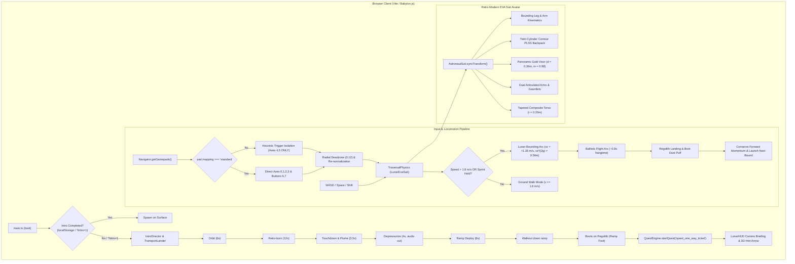

# Architectural Blueprint: Spec 28 — FTUE, Retro-Modern EVA Suit, Low-G Bounding Mechanics & Controller Rectification

## 1. System Topology & Event Flow



---

## 2. Component Interfaces & Data Contracts

### 2.1 FTUE Client Configuration Contract (`ClientAppOptions`)
```typescript
export interface ClientAppOptions {
  username?: string;
  faction?: string;
  role?: string;
  wsUrl?: string;
  seed?: string;
  /** Force FTUE intro playback or suppression */
  introQuery?: string;
  /** Storage backend for intro completion persistence */
  introStorage?: Storage;
  /** When true, automatically mount TransportLander and IntroDirector at startup */
  autoAttachIntroDirector?: boolean;
}
```

### 2.2 Locomotion Bounding Kinematics (`SuitState` & `TraversalPhysics`)
```typescript
export type SuitGaitMode = 'idle' | 'walk' | 'bounding_launch' | 'bounding_flight' | 'bounding_land';

export interface SuitState {
  x: number;
  y: number;
  z: number;
  vx: number;
  vy: number;
  vz: number;
  heading: number;
  pitch: number;
  isGrounded: boolean;
  gaitMode: SuitGaitMode;
  boundCycleTimer: number;
  hangTime: number;
  // ... existing telemetry fields
}

export const SUIT_BOUND_LAUNCH_VZ = 1.35; // m/s upwards impulse
export const SUIT_BOUND_FORWARD_SPEED = 5.0; // m/s forward sprint velocity
export const SUIT_BOUND_RESTITUTION = 0.88; // forward momentum retention on contact
```

### 2.3 Gamepad Stick Protection Contract (`ClientApp.ts`)
```typescript
export interface GamepadProfile {
  ltBipolar: boolean;
  rtBipolar: boolean;
  /** Never allow axes[2] or axes[3] to be classified as sliders */
  isStandardMapping: boolean;
}
```

---

## 3. Note to Future Self: Hosting Portability

- The FTUE arrival sequence and lander asset are 100% procedurally synthesized in Babylon.js and require zero external GLB downloads or network calls.
- Gamepad handling strictly respects W3C Gamepad API conventions across Chrome, Firefox, Safari, and Steam Deck / Linux XInput drivers.
- Offline and single-player modes operate identically to multi-player network shards.
