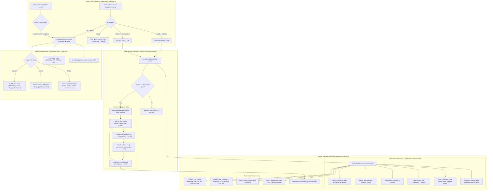

# Architectural Blueprint: Spec 30 — EVA Locomotion Overhaul, Stormtrooper Suit Aesthetics & Tactical HUD Controls Cleanup

## 1. System Topology & Event Flow



---

## 2. Component Interfaces & Data Contracts

### 2.1 Unilateral Locomotion State (`TraversalPhysics.ts`)

```typescript
export type SuitGaitMode = 'idle' | 'walk' | 'bounding';
export type HurryStrideLeg = 'left' | 'right';
export type HurryStepPhase = 'ground_brace' | 'flight_arc';

export interface SuitState {
  x: number;
  y: number;
  z: number;
  vx: number;
  vy: number;
  vz: number;
  heading: number;
  pitch: number;
  oxygen: number;
  battery: number;
  rcsFuel: number;
  isGrounded: boolean;
  gaitMode: SuitGaitMode;
  /** Active pushing / stance leg of the alternating stride. */
  hurryStrideLeg?: HurryStrideLeg;
  /** Phase within the unilateral stride cycle. */
  hurryStepPhase?: HurryStepPhase;
  /** Time spent airborne in the current unilateral bound (seconds). */
  hurryAirTime?: number;
  /** Vertical compression during the grounded brace phase (metres). */
  hurryBraceCompression?: number;
}
```

### 2.2 Stormtrooper Armor Model Metrics (`AstronautSuit.ts`)

```typescript
export const GEO = {
  torso: { y: 0.98, radius: 0.18, height: 0.58 },
  pectoralPlate: { y: 1.16, z: 0.09, width: 0.38, height: 0.30, depth: 0.16 },
  abdominalRibs: { y: 0.92, z: 0.06, width: 0.32, height: 0.22, depth: 0.14 },
  utilityBelt: { y: 0.74, width: 0.34, height: 0.08, depth: 0.32 },
  codpiece: { y: 0.68, z: 0.10, width: 0.16, height: 0.16, depth: 0.10 },
  beltCanister: { y: 0.74, dx: 0.18, radius: 0.045, height: 0.14 },
  helmet: { y: 1.48, diameter: 0.38, browRakeDeg: 5.0 },
  visor: { y: 1.48, z: 0.08, diameter: 0.36 },
  chinAerator: { y: 1.34, z: 0.12, dx: 0.08, radius: 0.035, length: 0.06 },
  plss: {
    tank: { y: 1.08, z: -0.42, dx: 0.12, radius: 0.085, height: 0.50 },
    cowl: { y: 1.08, z: -0.46, width: 0.16, height: 0.46, depth: 0.15 },
    nozzle: { y: 0.78, z: -0.40, dx: 0.10, diameter: 0.09, length: 0.12, tilt: 0.7 },
  },
  arm: {
    shoulderY: 1.22, shoulderDx: 0.26,
    pauldron: { radius: 0.09, height: 0.14, flareAngle: 0.26 },
    bicepRadius: 0.08, bicepHeight: 0.18,
    forearmRadius: 0.075, forearmHeight: 0.26,
    cuffDiameter: 0.14, cuffHeight: 0.06,
    glove: { width: 0.11, height: 0.16, depth: 0.09 },
  },
  leg: {
    hipY: 0.66, hipDx: 0.12,
    thighRadius: 0.115, thighHeight: 0.36,
    kneeCop: { width: 0.14, height: 0.12, depth: 0.12 },
    greaveRadius: 0.10, greaveHeight: 0.26,
    boot: { width: 0.14, height: 0.11, depth: 0.26 },
  },
} as const;
```

### 2.3 HUD Mode Controller Contract (`LunarHUD.ts`)

```typescript
export type HUDMode = 'standard' | 'minimal' | 'hidden';

export interface HUDVisibilityController {
  getMode(): HUDMode;
  setMode(mode: HUDMode): void;
  cycleMode(): HUDMode;
  isCinematicHidden(): boolean;
  isMinimal(): boolean;
  showToast(message: string, durationMs?: number): void;
}
```

---

## 3. Kinematic Formulations: Mistborn "Steelpush" Dynamics

### 3.1 Ground Contact & Brace Spring Model
During the grounded contact interval $\tau_\text{brace} \in [0, 0.12\,\text{s}]$, the stance leg acts as a damped elastic strut:
$$z_\text{compression}(t) = -A_\text{brace} \sin\left(\frac{\pi t}{\tau_\text{brace}}\right), \quad A_\text{brace} = 0.08\,\text{m}$$
This absorbs vertical impact velocity while storing kinetic strain energy for the forward push.

### 3.2 Steelpush Impulse Vectoring
At the conclusion of the brace phase ($t = \tau_\text{brace}$), the stance leg delivers an instantaneous reactive impulse $\vec{J} = m \Delta \vec{v}$ along the thrust vector:
$$\Delta v_z = v_{z,\text{launch}} = 1.55\,\text{m/s}$$
$$\Delta v_\text{thrust} = \Delta v_\text{step} \cdot \hat{u}_\text{heading} = 1.0\,\text{m/s} \cdot (\cos\psi, \sin\psi)$$
Forward speed is clamped to the maximum bounding envelope $v_\text{max} = 5.2\,\text{m/s}$.

### 3.3 Vacuum Ballistic Flight Arc
In the lunar vacuum frame ($C_d = 0$, $g = 1.62\,\text{m/s}^2$):
$$\vec{r}(t) = \vec{r}_0 + \vec{v}_0 t + \frac{1}{2} \begin{bmatrix} 0 \\ 0 \\ -g \end{bmatrix} t^2$$
Flight duration per unilateral leap:
$$\tau_\text{flight} = \frac{2 v_{z,\text{launch}}}{g} = \frac{2 \times 1.55}{1.62} \approx 1.91\,\text{s total} \quad (\approx 0.95\,\text{s stance-to-stance})$$
Apex elevation above ground:
$$\Delta z_\text{apex} = \frac{v_{z,\text{launch}}^2}{2 g} = \frac{1.55^2}{2 \times 1.62} \approx 0.74\,\text{m}$$
Distance covered per bounding stride:
$$D_\text{stride} = v_\text{forward} \cdot \tau_\text{flight} \approx 5.0\,\text{m/s} \times 0.95\,\text{s} \approx 4.75\,\text{m}$$

---

## 4. Input Architecture & Pointer Lock Protection

### 4.1 Key Event Mapping Matrix
| Key / Input | Action Identifier | Behavior |
| :--- | :--- | :--- |
| **`[U]` Key** | `'toggle-ui'` | Cycle HUD mode: `standard` $\to$ `minimal` $\to$ `hidden` $\to$ `standard`. Zero effect on pointer lock. |
| **`[H]` Key** | `'toggle-hud'` | Alias for `'toggle-ui'`. Direct HUD mode cycle. |
| **Gamepad `R3` Double-Tap** | `'toggle-ui'` | Detected via dual `buttons[11]` clicks within $350\,\text{ms}$. |
| **Gamepad `Back/View` Hold** | `'toggle-ui'` | Triggered on holding `buttons[8]` for $\ge 0.5\,\text{s}$. |
| **`Escape` Key** | `'close-modal'` | Dismisses active trade dialog or tactical map. Preserves canvas pointer lock. |
