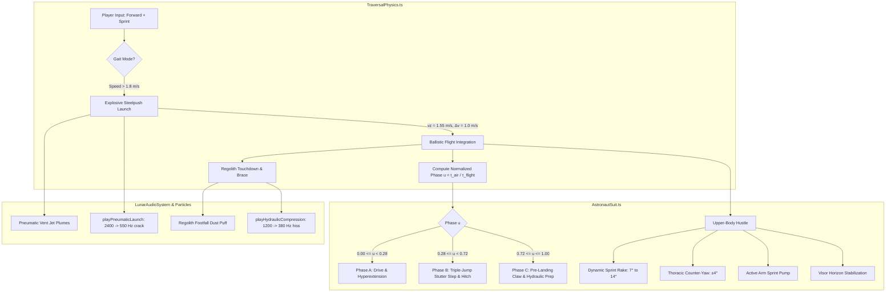

# Architecture Blueprint 31: Lunar Frontier High-Speed Steelpush Locomotion: Organic Ambient Hustle, Triple-Jump Mid-Air Stutter Cycle & Hydraulic Assist Boots

## 1. Context & Architectural Overview

Spec 30 established the foundational unilateral alternating stride state machine in `TraversalPhysics.ts` and introduced the Stormtrooper-inspired stylized composite armor mesh hierarchy in `AstronautSuit.ts`.

However, the kinematic expression remained rigid:
During the extended $\sim 1.9\,\text{s}$ low-gravity flight arc ($v_{z,\text{launch}} = 1.55\,\text{m/s}$, $g = 1.62\,\text{m/s}^2$), the suit remained in a single static pose (`hurryStridePose`), lacking the vitality and dynamic locomotion of athletic sprinting.

Blueprint 31 establishes the mathematical curves, dynamic multi-phase articulation state machine, and audio-visual feedback loops to model **Olympic Triple Jump** airborne hitch-kick mechanics and powered **hydraulic/pneumatic assist boots**.

---

## 2. Mathematical Modeling & Biomechanical Curves

### 2.1 Normalized Ballistic Trajectory Phase ($u$)

The low-gravity ballistic arc has analytical flight time:
$$\tau_\text{flight} = \frac{2 v_{z,\text{launch}}}{g} = \frac{2 \times 1.55}{1.62} \approx 1.9135\,\text{s}$$

At any time $t_\text{air}$ aloft:
$$u = \text{clamp}\left(\frac{t_\text{air}}{\tau_\text{flight}}, 0.0, 1.0\right)$$

### 2.2 Phase A: Takeoff Drive & Hyperextension ($0.0 \le u < 0.28$)
Let $t_A = \frac{u}{0.28} \in [0, 1]$.
- **Pushing Leg ($L_\text{push}$):**
  $$\theta_\text{hip,push}(t_A) = \text{lerp}(0.18, 0.62, t_A) \quad (\text{aft extension})$$
  $$\theta_\text{knee,push}(t_A) = \text{lerp}(0.50, 0.04, t_A) \quad (\text{straightening to toe-off})$$
- **Leading Leg ($L_\text{lead}$):**
  $$\theta_\text{hip,lead}(t_A) = \text{lerp}(-0.32, -0.58, t_A) \quad (\text{aggressive forward knee punch})$$
  $$\theta_\text{knee,lead}(t_A) = \text{lerp}(0.55, 1.05, t_A) \quad (\text{deep knee flexion})$$

### 2.3 Phase B: Olympic Triple-Jump Mid-Air Stutter & Hitch-Kick ($0.28 \le u < 0.72$)
Let $t_B = \frac{u - 0.28}{0.44} \in [0, 1]$.
A non-linear velocity pulse models the rapid athletic tuck and cycling hitch:
$$s(t_B) = \sin(\pi \cdot t_B)$$
- **Trailing Leg (cycling forward):**
  $$\theta_\text{hip,trail}(t_B) = \text{lerp}(0.62, -0.35, t_B) + 0.08 \cdot s(t_B)$$
  $$\theta_\text{knee,trail}(t_B) = \text{lerp}(0.04, 1.15, \sin(\pi t_B / 2))$$
- **Leading Leg (cycling downward into claw):**
  $$\theta_\text{hip,lead}(t_B) = \text{lerp}(-0.58, -0.15, t_B) - 0.06 \cdot s(t_B)$$
  $$\theta_\text{knee,lead}(t_B) = \text{lerp}(1.05, 0.50, t_B)$$

### 2.4 Phase C: Pre-Landing Claw & Hydraulic Priming ($0.72 \le u \le 1.0$)
Let $t_C = \frac{u - 0.72}{0.28} \in [0, 1]$.
- **Landing Leg (reaching and clawing toward ground datum):**
  $$\theta_\text{hip,land}(t_C) = \text{lerp}(-0.15, -0.42, t_C)$$
  $$\theta_\text{knee,land}(t_C) = \text{lerp}(0.50, 0.35, t_C)$$
- **Opposite Recovery Leg (cocked high for next stroke):**
  $$\theta_\text{hip,rec}(t_C) = \text{lerp}(-0.35, -0.50, t_C)$$
  $$\theta_\text{knee,rec}(t_C) = \text{lerp}(1.15, 0.90, t_C)$$

### 2.5 Dynamic Sprint Rake & Upper-Body Coordination
- **Torso Forward Rake:**
  $$v_\text{fwd} = \sqrt{v_x^2 + v_y^2}$$
  $$\alpha_\text{rake}(v) = \text{lerp}(0.12, 0.24, \text{clamp}((v_\text{fwd} - 1.8) / (5.2 - 1.8), 0, 1))$$
  $$\theta_\text{torso,pitch} = \alpha_\text{rake} + 0.026 \cdot \sin(2\pi u) \quad (\text{spinal breathing pulse})$$
- **Thoracic Counter-Yaw:**
  $$\theta_\text{torso,yaw} = \pm 0.07 \cdot \cos(\pi u) \quad (\approx 4^\circ \text{ counter-twist against pelvis})$$
- **Arm Sprint Pumping:**
  $$\theta_\text{arm,stance}(u) = -0.55 \cdot \cos(\pi u)$$
  $$\theta_\text{arm,rec}(u) = +0.45 \cdot \cos(\pi u)$$
- **Head Visor Horizon Lock:**
  $$\theta_\text{head,pitch} = -0.65 \cdot \theta_\text{torso,pitch}$$

---

## 3. Assist Boot Pneumatic / Hydraulic Synthesis (`LunarAudioSystem.ts`)

### 3.1 `playHydraulicCompression()`
- Triggered on touchdown edge entering `ground_brace`.
- **Acoustic Graph:**
  - White noise source $\to$ BandPass Filter ($Q = 3.5$, center frequency swept exponentially $1200\,\text{Hz} \to 380\,\text{Hz}$ in $0.09\,\text{s}$).
  - Low-frequency mechanical thump: Sine oscillator ($60\,\text{Hz}$ with $25\,\text{ms}$ decay).
  - Damped gain envelope: attack $0.005\,\text{s}$, decay $0.085\,\text{s}$.

### 3.2 `playPneumaticLaunch()`
- Triggered on Steelpush launch edge entering `flight_arc`.
- **Acoustic Graph:**
  - High-pressure gas vent: Noise source $\to$ HighPass/BandPass Filter swept $2400\,\text{Hz} \to 550\,\text{Hz}$ in $0.11\,\text{s}$.
  - Kinetic impulse pop: Sine wave swept $110\,\text{Hz} \to 45\,\text{Hz}$ in $0.06\,\text{s}$.
  - Peak gain: $0.22$, decaying cleanly without DC offset.

---

## 4. Visual Pneumatic Jet Emitter (`AstronautSuit.ts`)

A dedicated twin particle nozzle system mounted at the aft boot heel spurs:
- Local offset: `(±0.06, -0.05, -0.12)` relative to the launching boot sole.
- Velocity vector: $\vec{v}_\text{vent} = (-4.0 \cdot \vec{d}_\text{fwd} - 2.5 \cdot \vec{k}_\text{up})\,\text{m/s}$.
- Particle size: $0.04\,\text{m} \to 0.14\,\text{m}$ puff expansion.
- Lifetime: $0.20\,\text{s}$.

---

## 5. 💡 Note to Future Self: Hosting Portability

All kinematic curves, phase evaluations, and procedural audio graphs are 100% self-contained in TypeScript without external binary dependencies or server coupling.
1. **Headless Execution Compatibility:** The entire suite executes deterministically in Node.js headless environments (`NullEngine` + mock `AudioContext`).
2. **Determinism:** All math relies purely on analytical parameterization of $u = t / \tau_\text{flight}$ rather than unpredictable accumulation of physics deltas, ensuring identical animations across 30 FPS, 60 FPS, 120 FPS, and variable-rate headless runners.
3. **Multiplayer Replication Ready:** Because flight phase is a direct function of ballistic velocity and time-of-flight, remote clients in multiplayer can evaluate the exact same visual posture simply by sharing `launchTime`, `vz`, and `hurryStrideLeg`, requiring zero per-frame bone synchronization packets over the WebSocket connection.
