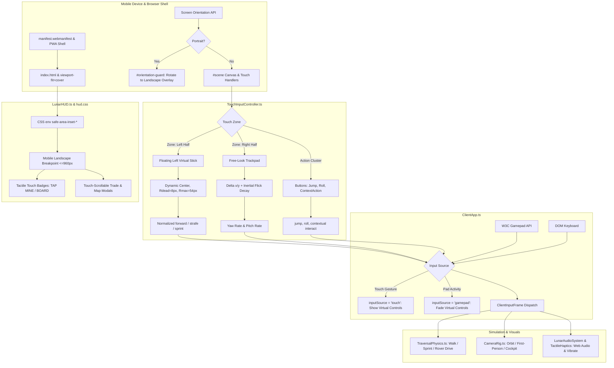

# Architecture Blueprint 33: Lunar Frontier Mobile Touch Client, Virtual Dual-Sticks, Safe-Area Responsive HUD & PWA Harness

## 1. Context & Architectural Overview

`games/lunar-frontier` requires first-class mobile device support (iOS / iPadOS Safari and Android Chrome) so players can explore the lunar surface, drive rovers, mine mineral veins, and execute trade orders directly on touchscreen smartphones and tablets.

Historically, the client was designed exclusively for desktop keyboard/mouse and gamepad inputs. On mobile hardware, this created several architectural blocks:
1. **Absence of Touch Movement & Action:** `ClientApp.ts` only polled `this.pressed` (keyboard keys) and `pollGamepad()`. Touch events on the canvas did not feed into the physics movement pipeline (`ClientInputFrame`).
2. **Camera Fighting & Gesture Collisions:** Touch drags conflicted with browser scroll/zoom and lacked look-pitch/yaw sensitivity mapping with inertial decay.
3. **Safe-Area Collisions:** Desktop HUD elements collided with modern phone cutouts (Dynamic Island, notches, curved corners, and iOS gesture home indicator bars) due to unmanaged viewport padding.
4. **Desktop Dialog Scaling:** Modal screens (Commodity Trading Terminal, Topographic Map) overflowed small landscape viewports and lacked touch-friendly tap targets ($\ge 44\text{px}$).
5. **High-DPI Thermal Throttling:** Uncapped 3x DPR rendering on mobile GPUs caused severe overheating, battery drain, and frame-rate collapse.
6. **Mobile Web Audio & Haptics:** AudioContext remained muted due to mobile browser user-gesture restrictions, while tactile haptic capabilities went unused.

Blueprint 33 establishes the unified mobile architecture:



---

## 2. Mathematical Formulations & Component Specifications

### 2.1 Floating Dynamic Left Virtual Stick (`TouchInputController.ts`)

To avoid requiring players to look at thumb placement, the virtual stick origin $(\bar{x}, \bar{y})$ anchors dynamically to the initial `touchstart` event within the movement zone ($X \in [0, 42vw], Y \in [35vh, 100vh]$).

1. **Displacement Vector & Radial Normalization:**
   $$\vec{d} = (x_\text{current} - \bar{x}, \; y_\text{current} - \bar{y})$$
   $$r = \|\vec{d}\| = \sqrt{d_x^2 + d_y^2}$$
2. **Deadzone & Outer Clamp Bounds:**
   - Inner deadzone: $R_\text{dead} = 8\,\text{px}$ (prevents micro-jitter from finger resting).
   - Outer maximum radius: $R_\text{max} = 54\,\text{px}$.
   - If $r \le R_\text{dead}$:
     $$\text{demand}_x = 0, \quad \text{demand}_y = 0$$
   - If $r > R_\text{dead}$:
     $$r_\text{clamped} = \min(r, R_\text{max})$$
     $$r_\text{norm} = \frac{r_\text{clamped} - R_\text{dead}}{R_\text{max} - R_\text{dead}} \in [0, 1]$$
     $$\hat{u} = \frac{\vec{d}}{r}$$
     $$\text{strafe} = \hat{u}_x \cdot r_\text{norm} \quad (\text{positive = right strafe})$$
     $$\text{forward} = -\hat{u}_y \cdot r_\text{norm} \quad (\text{negative Y screen delta = forward})$$
3. **Sprint Latch via Deflection Hold:**
   If $r_\text{norm} \ge 0.90$ continuously for $t_\text{hold} \ge 300\,\text{ms}$, or if outward velocity exceeds $1.2\,\text{px/ms}$, activate `sprint: true`.

---

### 2.2 Free-Look Touch Trackpad with Inertial Decay (`TouchInputController.ts`)

1. **Differential Angular Velocity:**
   For a touch drag with displacement per frame $(\Delta x, \Delta y)$:
   $$\Delta \theta_\text{yaw} = \Delta x \cdot S_\text{yaw}, \quad S_\text{yaw} = 0.0035\,\text{rad/px}$$
   $$\Delta \theta_\text{pitch} = -\Delta y \cdot S_\text{pitch}, \quad S_\text{pitch} = 0.0028\,\text{rad/px}$$
2. **Inertial Coasting & Flick Decay:**
   On `touchend`, sample the release velocity $\vec{v}_\text{flick} = (\Delta x / \Delta t, \Delta y / \Delta t)$.
   If $\|\vec{v}_\text{flick}\| > v_\text{threshold} = 0.4\,\text{px/ms}$:
   Initialize coasting velocity $\vec{v}_\text{coast}(0) = \vec{v}_\text{flick}$.
   On subsequent frames:
   $$\vec{v}_\text{coast}(t + \Delta t) = \vec{v}_\text{coast}(t) \cdot e^{-\Delta t / \tau_\text{decay}}, \quad \tau_\text{decay} = 0.12\,\text{s}$$
   Terminate coasting when $\|\vec{v}_\text{coast}\| < 0.05\,\text{px/ms}$.

---

### 2.3 Responsive Safe-Area Matrix & Breakpoints (`hud.css`)

```css
:root {
  --safe-top: max(8px, env(safe-area-inset-top));
  --safe-bottom: max(8px, env(safe-area-inset-bottom));
  --safe-left: max(12px, env(safe-area-inset-left));
  --safe-right: max(12px, env(safe-area-inset-right));
}

/* Landscape Phone Layout Matrix */
@media (max-width: 960px) and (orientation: landscape) {
  #lunar-hud {
    padding: var(--safe-top) var(--safe-right) var(--safe-bottom) var(--safe-left);
  }
  
  /* Compact Compass Tape: 48vw width, prioritized POI chevrons */
  .lunar-hud-compass {
    width: 48vw;
    font-size: 10px;
  }
  
  /* Unified Life-Support Telemetry Pill */
  .lunar-hud-telemetry {
    position: fixed;
    top: var(--safe-top);
    right: var(--safe-right);
    scale: 0.85;
    transform-origin: top right;
  }
  
  /* Contextual Action Button: 56px touch target */
  .touch-action-btn {
    min-width: 56px;
    min-height: 56px;
    border-radius: 28px;
    touch-action: manipulation;
  }
}
```

---

### 2.4 High-DPI Clamping & Performance Scaling (`MobileSettings.ts`)

To protect mobile battery and prevent thermal throttling:
$$DPR_\text{effective} = \min\left(DPR_\text{device}, \; DPR_\text{profile}\right)$$
- **Battery Saver:** $DPR_\text{profile} = 1.0$, Render loop rate cap $= 30\,\text{FPS}$, shadows disabled.
- **Balanced (Default):** $DPR_\text{profile} = 1.5$, Render loop rate cap $= 60\,\text{FPS}$, single cascade shadow map.
- **High Fidelity:** $DPR_\text{profile} = 2.0$, Full shadows, volumetric headlights.

Hardware scaling level applied to Babylon engine:
$$\text{hardwareScalingLevel} = \frac{1}{DPR_\text{effective}}$$

---

### 2.5 Tactile Haptics Protocol (`TactileHaptics.ts`)

Duck-typed wrapping around `navigator.vibrate`:
- `touchdown`: `navigator.vibrate(12)`
- `rcs_boost`: `navigator.vibrate([15, 30, 20])`
- `mining_laser`: `navigator.vibrate(25)`
- `vehicle_impact`: `navigator.vibrate(60)`
Safe-guarded to no-op when `typeof navigator === 'undefined'` or `!navigator.vibrate` (e.g. headless Node or Safari iOS without vibration API).
