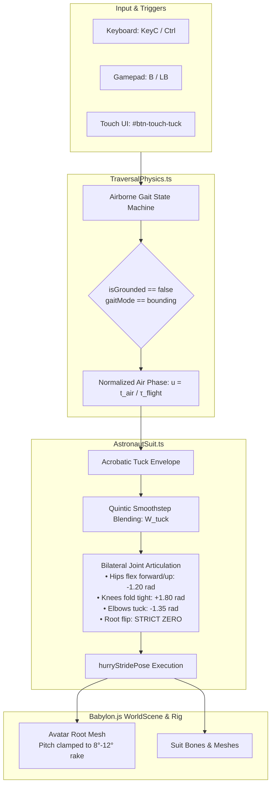

# Architecture Blueprint 35: Fluid Low-G Airborne Leg Tuck & Kinematic Bounding Rectification

## System Topology & Component Interactions

## Mathematical Formulations
- **Tuck Blending Curve:** $W_\text{tuck}(u)$ parameterized by quintic smoothstep $S(x) = 6x^5 - 15x^4 + 10x^3$ across $u \in [0.15, 0.90]$.
- **Root Pitch Decoupling:** Somersault pitch $\Delta\theta_\text{flip} \equiv 0$. Root orientation strictly driven by camera heading and velocity rake vector.
- **Continuous Velocity Preservation:** Forward momentum is completely conserved during tuck, guaranteeing ballistic parabolic trajectories are unperturbed by limb kinematics.

## File Manifest & Responsibility Map
- `games/lunar-frontier/src/entities/AstronautSuit.ts`: Pose generation, tuck envelope constants, smoothstep blending functions.
- `games/lunar-frontier/src/physics/TraversalPhysics.ts`: State management and airborne phase tracking.
- `games/lunar-frontier/scripts/smoke-spec35-airborne-tuck.ts`: Headless NullEngine assertion test harness.
