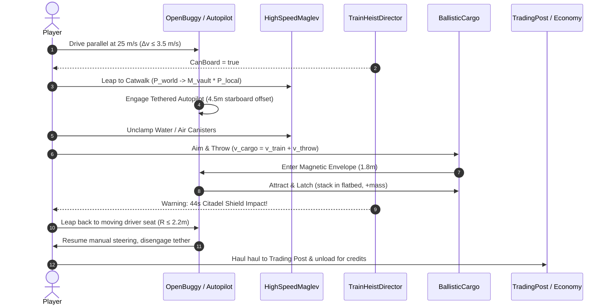

# Architecture Blueprint 36: High-Speed Train Heist Overhaul — Moving Cargo Toss & Dynamic Buggy Boarding

## System Topology & Event Flow

## Physical Capture & Ballistic Envelopes
- **Cargo Ballistics:** $\vec{r}(t) = \vec{r}_0 + (\vec{v}_\text{train} + \vec{v}_\text{throw})t + \frac{1}{2}\vec{g}t^2$ in vacuum ($C_d = 0$, $g = 1.62\,\text{m/s}^2$).
- **Electromagnetic Hopper Attractor:** $\vec{F}_\text{mag} = -k_\text{mag}\hat{r} - c_\text{damp}\Delta\vec{v}$ within $R_\text{catch} = 1.8\,\text{m}$.
- **Moving Driver Seat Capture:** Kinematic handoff from airborne avatar to buggy chassis coordinate frame within $R_\text{board} \le 2.2\,\text{m}$.

## File Manifest & Responsibility Map
- `games/lunar-frontier/src/quests/TrainHeistDirector.ts`: Heist state machine, cargo unclamp triggers, throw aim logic, re-boarding arbiter.
- `games/lunar-frontier/src/entities/OpenBuggy.ts`: Cargo hopper bounds, physical canister mesh instantiation, dynamic mass loading.
- `games/lunar-frontier/src/client/ClientApp.ts`: User input routing, throw projection HUD, seat transition dispatch.
- `games/lunar-frontier/scripts/smoke-spec36-heist-overhaul.ts`: Complete headless NullEngine verification suite.
