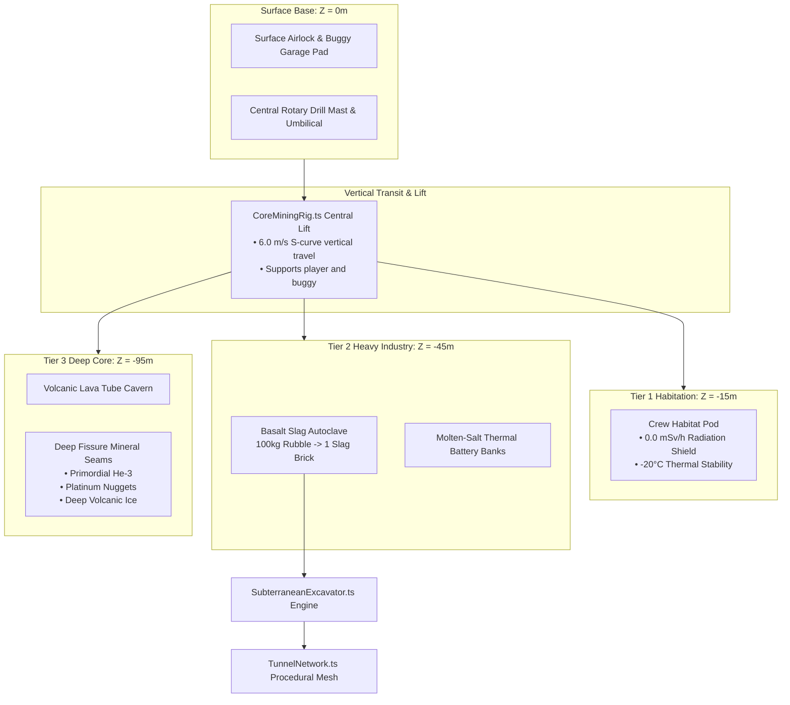

# Architecture Blueprint 38: Subterranean Base Excavation & Deep Core Shaft Mining

## System Topology & Spatial Hierarchy

## Depth & Environmental Attributes
- **Tier 0 ($Z = 0\,\text{m}$):** Vacuum $0.0\,\text{kPa}$, solar radiation $1.2\,\text{mSv/h}$, temp range $-130^\circ\text{C} \dots +120^\circ\text{C}$.
- **Tier 1 ($Z = -15\,\text{m}$):** Pressurized $101.3\,\text{kPa}$ in habitat, radiation $0.0\,\text{mSv/h}$, temp $-20^\circ\text{C}$.
- **Tier 2 ($Z = -45\,\text{m}$):** Industrial volume $36\,\text{m} \times 36\,\text{m} \times 9\,\text{m}$, slag production and energy routing.
- **Tier 3 ($Z = -95\,\text{m}$):** Massive arched cavern $60\,\text{m} \times 80\,\text{m} \times 14\,\text{m}$, geothermal core tap and rare mineral nodes.

## File Manifest & Responsibility Map
- `games/lunar-frontier/src/base/SubterraneanExcavator.ts`: Tier unlocking rules, rubble accumulation, slag sintering formulas, state serialization.
- `games/lunar-frontier/src/base/CoreMiningRig.ts`: Rotary drill asset rig, particle emitters, elevator platform kinematics.
- `games/lunar-frontier/src/infrastructure/TunnelNetwork.ts`: Procedural 3D mesh generation for shafts, rings, and cavern walls.
- `games/lunar-frontier/scripts/smoke-spec38-core-excavation.ts`: Headless NullEngine assertion test harness.
