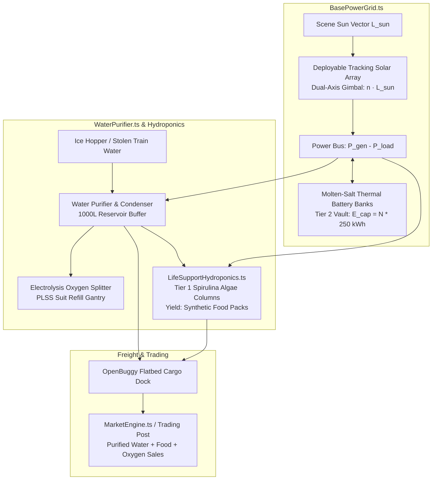

# Architecture Blueprint 39: Colony Life-Support Infrastructure — Tracking Solar Arrays, Closed-Loop Hydroponics & Water Refining

## System Topology & Grid Mechanics

## Physical Energy & Material Equations
- **Solar Power Generation:** $P_\text{gen} = P_\text{peak} \cdot \max(0, \vec{n} \cdot \vec{L}_\text{sun}) \cdot \eta$ with $P_\text{peak} = 45\,\text{kW}$.
- **Closed-Loop Water Balance:** $\Delta V_\text{water} = \dot{V}_\text{melt} - \dot{V}_\text{hydro} - \dot{V}_\text{electrolysis}$.
- **Algae Food Cultivation Cycle:** 1 food pack per $180.0\,\text{s}$ at nominal power ($2.5\,\text{kW}$) and water ($0.5\,\text{L/h}$).

## File Manifest & Responsibility Map
- `games/lunar-frontier/src/base/BasePowerGrid.ts`: Solar tracking math, battery charge/discharge differential solver, blackout triggers.
- `games/lunar-frontier/src/base/WaterPurifier.ts`: Ice sublimation, condenser tank buffers, suit oxygen dispenser.
- `games/lunar-frontier/src/base/LifeSupportHydroponics.ts`: Algae growth timing, ration packaging, ambient chamber lighting.
- `games/lunar-frontier/scripts/smoke-spec39-base-infrastructure.ts`: Headless NullEngine assertion test harness.
