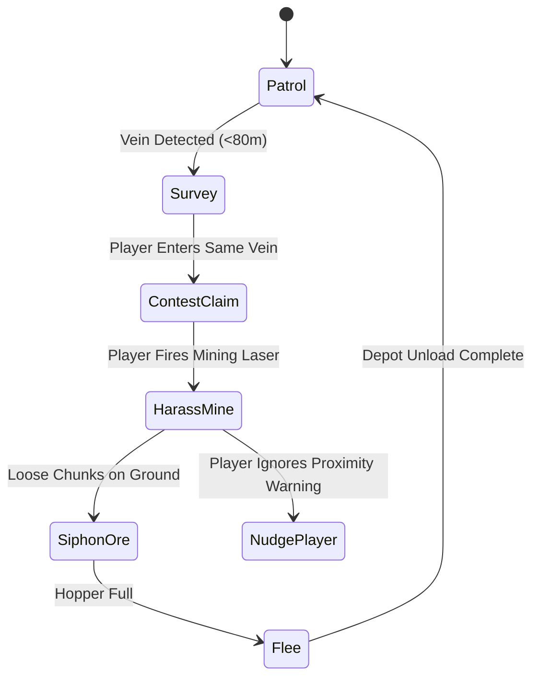
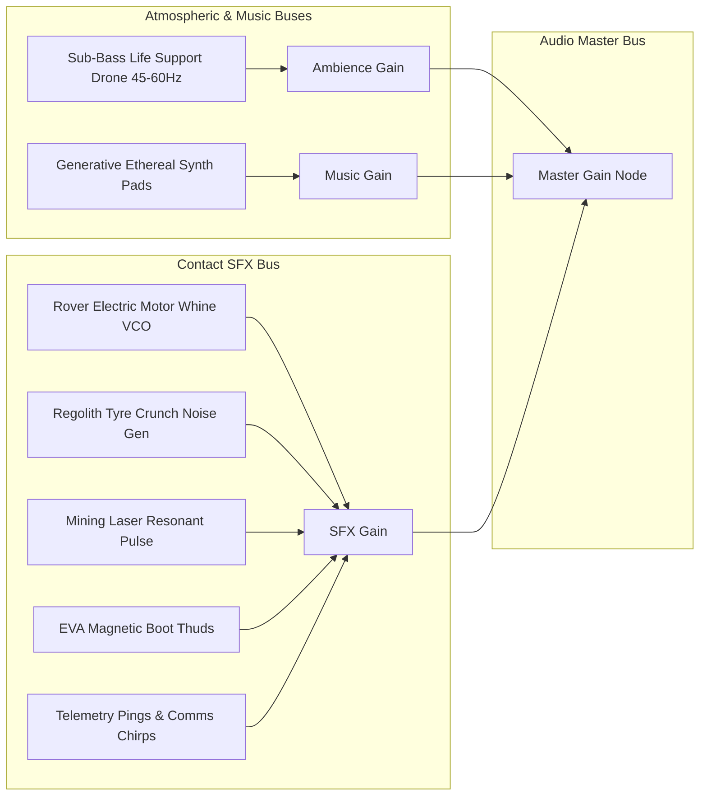
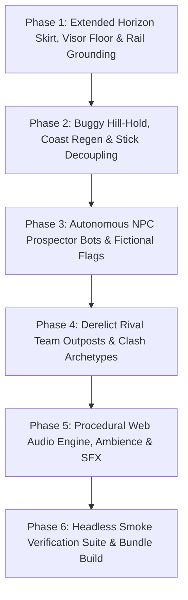

# Spec 25: Lunar Frontier — Misc General Cleanup & Frontier World Expansion

> **Target Systems:** `games/lunar-frontier/src/engine/WorldScene.ts`, `games/lunar-frontier/src/infrastructure/RailSystem.ts`, `games/lunar-frontier/src/physics/TraversalPhysics.ts`, `games/lunar-frontier/src/client/ClientApp.ts`, `games/lunar-frontier/src/entities/NPCProspectorBot.ts` (new), `games/lunar-frontier/src/infrastructure/RivalBases.ts` (new), `games/lunar-frontier/src/audio/LunarAudioSystem.ts` (new), `games/lunar-frontier/src/ui/LunarHUD.ts`.  
> **Platforms:** WebGL2/WebGPU Desktop (Chrome/Firefox), Steam Deck & Handhelds (GPD Win Max 2, Gamepad API).  
> **Preceding Specs:** Spec 12 (Multiplayer & Economy), Spec 14 (Visual & Terrain Overhaul), Spec 17 (Proving Grounds & Steering), Spec 18 (Quest Framework), Spec 19 (Gamepad & Mining UX), Spec 20 (Hill-Hold & Decoupled Controls Concept), Spec 21 (World Building), Spec 23 (Surface Rendering & Visor Exposure), Spec 24 (Transport Arrival Experience).

---

## 1. Executive Summary & Problem Statement

*Lunar Frontier* has established core locomotion, multiplayer networking, industrial mining, and cinematic onboarding. However, recurring playtesting identifies five critical immersion, physics, and gameplay friction points:

1. **Terrain Edge Void & Floating Rail Tracks:**
   - The current terrain mesh is a bounded $1,024\,\text{m} \times 1,024\,\text{m}$ square patch, whereas procedural world features (crater networks, outposts, and rail lines) span up to $8,000\,\text{m} \times 6,000\,\text{m}$.
   - Driving beyond the 1 km boundary causes the terrain to drop off abruptly into the pure black void of space (`scene.clearColor = (0, 0, 0, 1)`).
   - Ore train tracks stretch far beyond the terrain patch, creating an ungrounded visual defect where steel rails and freight carts float unsupported in pitch-black vacuum.
   - Deep shadow regions and low-sun crater floors frequently drop below human eye contrast, making the surface indistinguishable from empty space.

2. **Unprompted Buggy Forward Acceleration:**
   - In lunar 1/6th gravity ($g = 1.62\,\text{m/s}^2$) with rolling resistance in vacuum, any incline $\theta \ge 2.0^\circ$ causes downhill gravitational force to exceed tyre rolling resistance.
   - When the driver releases the throttle stick/triggers, regenerative coast-down braking is currently zero, and the physics state machine requires $|v| < 0.2\,\text{m/s}$ to enter `STOPPED`. As a result, the rover accelerates forward indefinitely down slopes without stick input.
   - Furthermore, analog gamepad trigger rails (particularly on Linux XInput and DirectInput devices where triggers rest at $-1.0$) and stick axis noise occasionally leak small positive throttle offsets into `baseForward`.

3. **Absence of Autonomous Frontier Competitors (NPC Bots):**
   - The lunar frontier feels abandoned when other human players are offline.
   - There are no automated rovers contesting high-yield mineral veins, racing the player to rich outcrops, or harassing mining operations in the untamed corporate badlands.
   - Fictional nation-states and breakaway corporate republics are referenced in lore but lack physical representation on the surface.

4. **Lack of Rival Faction Outposts (Pre-Clash Foundation):**
   - The world lacks visible competitor infrastructure. Existing bases are limited to generic procedural domes without territorial identity.
   - To lay the foundation for future "Clash of Clans"-style territorial conflict, the frontier requires distinct rival team bases built in different architectural styles.
   - These outposts should not look pristine or brand-new; they must appear weathered, battle-damaged, makeshift, and visibly degraded by harsh lunar conditions and territorial skirmishes.

5. **Complete Lack of Audio Immersion:**
   - While lunar vacuum prevents airborne sound transmission, spacesuit helmet bone conduction, cabin life-support air, and direct mechanical contact with the rover chassis conduct distinct vibrations.
   - Currently, *Lunar Frontier* operates in complete digital silence with zero audio feedback.
   - The game requires a zero-asset procedural Web Audio synthesizer delivering low-frequency life-support ambience, subtle generative sci-fi music pads, and physical contact sound effects (motor whine, regolith tyre crunch, mining laser resonance, and telemetry chirps).

---

## 2. Core Architectural Design & Feature Specifications


---

### 2.1 Feature 1: Visible Ground Everywhere, Extended Skirt & Ballast Anchor

#### 2.1.1 Macro Terrain Skirt & Continuous Planetary Crust
- In `WorldScene.ts`, the primary high-resolution heightmap patch ($1,024\,\text{m} \times 1,024\,\text{m}$) remains centered at the player's primary operating area.
- Add an outer **Planetary Crust Skirt Mesh** extending from $r = 500\,\text{m}$ outward to $r = 12,000\,\text{m}$:
  - Modeled as concentric radial rings with progressive geometric decimation (LOD) matching the spherical curvature of the Moon ($R_\text{moon} = 1,737.4\,\text{km}$).
  - All vertices sample elevation directly from `LunarWorldGenerator.elevationAt(wx, wy)`, ensuring seamless continuity with the central patch.
  - The skirt boundary extends well beyond the farthest world sector ($8,000\,\text{m} \times 6,000\,\text{m}$), guaranteeing that no matter where the rover drives, the horizon meets the lunar curve rather than dropping into empty black space.

#### 2.1.2 In-Fiction Visor Exposure Compensation & Albedo Floor
- Space vacuum does not scatter light, but modern contractor EVA visors feature digital High Dynamic Range (HDR) auto-gain and sensor compression:
- Enforce an absolute minimum luminance floor on all regolith surface materials:
  - `VISOR_EMISSIVE_FLOOR = { r: 0.16, g: 0.16, b: 0.18 }` (elevated from 0.12).
  - Ambient hemispheric bounce `earthshineFill` raised to $0.65$ with ground bounce color `{ r: 0.20, g: 0.20, b: 0.22 }`.
  - In shadow zones and unlit craters, the ground retains a clear slate-charcoal tonal separation ($L^* \ge 18\%$) that contrasts sharply with the pitch-black celestial sphere (`#000000`) and starfield.

#### 2.1.3 Rail System Terrain Clamping & Embankment Berms
- In `RailSystem.ts`, every track polyline node $(x, y, z)$ is verified against `worldGen.elevationAt(x, y)`:
  - Any track segment that previously evaluated above ground level is anchored with an automated crushed-basalt **ballast embankment berm** geometry underneath the transverse ties.
  - No tie, sleeper, or rail tube may exist without a continuous ground or berm structure beneath it.

---

### 2.2 Feature 2: Buggy Powertrain Hill-Hold, Coast Deceleration & Stick Decoupling

#### 2.2.1 Automatic Powertrain Regenerative Coast Deceleration
- In `TraversalPhysics.ts`, when driver throttle demand is in the neutral deadband ($|\text{throttle}| \le 0.05$) and forward speed exceeds $|v_\text{long}| > 0.35\,\text{m/s}$:
  - Engage automatic electric motor regenerative braking with a retarding force of $F_\text{regen} = 1,800\,\text{N}$.
  - Under lunar conditions, this smoothly brings a coasting $750\,\text{kg}$ rover from cruise ($10\,\text{m/s}$) to a controlled stop within $\approx 4.0\,\text{s}$ instead of coasting or accelerating downhill indefinitely.

#### 2.2.2 Active Mechanical Hill-Hold & Slope Gravity Cancellation
- When rover velocity drops below $|v_\text{long}| \le 0.35\,\text{m/s}$ and throttle is neutral:
  - `driveMode` transitions directly to `'STOPPED'`.
  - While `'STOPPED'`, engage rigid mechanical hill-hold:
    - Counteract the longitudinal and lateral slope gravity components:
      $$F_{\text{hill\_hold}} = -m \cdot g \cdot \sin(\theta_{\text{slope}})$$
    - Up to a slope angle of $\theta \le 35^\circ$ (the angle of repose of lunar regolith), the contact patches are mechanically locked, resulting in exactly $0.00\,\text{m/s}$ forward or backward drift.
- The instant driver throttle exceeds $|\text{throttle}| > 0.05$, hill-hold releases smoothly with an anti-jerk slew rate ($12.0\,\text{s}^{-1}$), enabling clean hill starts without rollback.

#### 2.2.3 Gamepad Channel Decoupling & Defensive Trigger Clamping
- In `ClientApp.ts`:
  - Enforce a strict $0.15$ deadzone across left stick Y and right stick Y before computing throttle.
  - Remove legacy fallback bleeding (`const steerInput = frame.strafe !== 0 ? frame.strafe : frame.yaw;`). Steering inputs and camera yaw inputs must remain 100% decoupled.
  - Initialize trigger profiles with safe resting baselines ($0.0$) so uncalibrated Linux bipolar axes ($[-1, 1]$) never emit forward throttle while untouched.

---

### 2.3 Feature 3: Autonomous NPC Prospector Bots & Fictional Flag Banners

#### 2.3.1 NPC Bot Entity Architecture (`NPCProspectorBot.ts`)
- Automated prospecting rovers roaming the frontier autonomously:
  - Constructed using lightweight modular chassis meshes (compact heavy-duty rover frame, front dual mining drill/laser arm, top-mounted scanning antenna, rear cargo hopper).
  - Physics driven by a lightweight raycast kinematic model running at 20 Hz, matching terrain contours seamlessly.
  - Spawns $3\text{--}6$ autonomous bots across key resource sectors.

#### 2.3.2 Fictional Nation-State & Faction Heraldry
- Every bot mounts a flexible carbon-composite flagpole flying a dynamic waving pennant/flag representing fictional lunar factions:
  1. **Republic of Caelum (RCL):** Deep navy banner with golden celestial compass star; methodical, state-funded survey rovers.
  2. **United Sol Syndicate (USS):** Crimson and charcoal chevron banner; aggressive industrial strip-miners.
  3. **Valles Marineris Conglomerate (VMC):** Rust-orange and white dual-stripe flag; scrappy, high-speed prospecting scouts.
  4. **New Borealis Commonwealth (NBC):** Emerald green and silver polar aurora flag; specialized ice-harvesters.
- Flags feature subtle vertex-shader wind/inertia flutter reacting to rover acceleration and turns.

#### 2.3.3 Behavior State Machine & Mining Harassment Loop


- **Patrol:** Wanders between mineral nodes and terrain waypoints.
- **Survey:** Scans surface deposits using a sweeping yellow sensor cone.
- **Contest Claim:** If the player approaches within $25\,\text{m}$ of the same vein, the bot activates flashing strobe beacons and broadcasts territorial comms chatter:
  > *"Warning: Sector claim registered to United Sol Syndicate. Vacate perimeter."*
- **Harass Mine:**
  - If the player begins mining, the bot attempts to position itself between the player and the vein, firing its own mining beam to extract yield.
  - **Dynamic Nudge / Shove:** If the player continues, the bot executes low-speed physical bumps against the player's rover, imparting non-destructive collision impulses ($1,500\,\text{N}\cdot\text{s}$) that rock the chassis.
  - **Siphon Ore:** Hoover up loose floating ore chunks within $5\,\text{m}$ before the player can collect them.

---

### 2.4 Feature 4: Dilapidated Rival Team Outposts (Pre-Clash Foundation)

#### 2.4.1 Architectural Styles & Rival Teams (`RivalBases.ts`)
Introduce three distinct rival outpost archetypes positioned at key strategic crater hubs:

1. **The Scrapper Syndicate Fortress (Sector South):**
   - **Style:** Brutalist, jury-rigged scrap redoubt.
   - **Elements:** Welded titanium rocket casing segments, corrugated blast shields, leaning scaffolding, diesel generator exhaust stacks emitting dark particulate soot, and razor-wire perimeters.
   - **Condition:** Severe structural wear—rusted panels, dented plates, improvised structural shoring, oil leaks on regolith.

2. **The Derelict Corporate Enclave (Sector West):**
   - **Style:** Once-luxurious corporate research station fallen on hard times.
   - **Elements:** Pressurized geodesic dome, large parabolic uplink dish, executive personnel habitat pods.
   - **Condition:** Compromised integrity—cracked outer dome glass with emergency sealant foam, scorch marks from thruster accidents, tilted dish mast held by guy wires, flickering fluorescent exterior lamps.

3. **The Nomad Drilling Rig (Sector North-East):**
   - **Style:** Mega-scale mobile planetary crawler grounded permanently.
   - **Elements:** Massive multi-track tread assemblies, heavy rotary bucket excavator arm, fuel storage spheres.
   - **Condition:** Abandoned/grounded state—cracked hydraulic fluid hoses, missing track treads, rusted catwalks, flickering emergency beacon.

#### 2.4.2 Clash-of-Clans Foundation Contracts
- Each base is wrapped in an interactive structure containing:
  - **Territory Radius ($\approx 60\text{--}90\,\text{m}$):** Defined boundary marked by decaying pylons.
  - **Core Command Hub:** The primary structure holding the base's faction banner.
  - **Defense Turret Sockets (2–4 per base):** Inoperable/damaged point-defense railgun emplacements (flickering red targeting lasers, sparks discharging from broken capacitors).
  - **Resource Depots:** Damaged hoppers that players can survey or scavenge for scrap metal.

---

### 2.5 Feature 5: Procedural Web Audio System & Sound Design

#### 2.5.1 Architecture: `LunarAudioSystem.ts`
- Implemented purely via native browser **Web Audio API** (`AudioContext`, `OscillatorNode`, `BiquadFilterNode`, `GainNode`, `ConvolverNode` / synthetic reverb).
- **Zero Asset Dependencies:** $100\%$ synthesized procedural audio—zero MP3/WAV files to download, zero network latency, zero licensing issues, and 100% testable via mock AudioContext in headless CI.

#### 2.5.2 Audio Landscape & Sound Palette



1. **Ambient Life-Support Soundscape:**
   - Deep, resonant suit life-support drone: Dual sine oscillators at $48\,\text{Hz}$ and $52\,\text{Hz}$ with a slow $0.15\,\text{Hz}$ LFO pulse, simulating suit air circulation fans and helmet cavity acoustics.
2. **Generative Space Ambient Music:**
   - Procedural pentatonic chord progressions using warm triangle/sine waves passing through a steep $800\,\text{Hz}$ low-pass filter with slow attack ($2.5\,\text{s}$) and decay ($4.0\,\text{s}$). Subtly triggers every $12\text{--}20\,\text{s}$.
3. **Powertrain & Driving Sound Effects:**
   - **Electric Motor Whine:** Sawtooth oscillator modulated by rover ground speed ($v_\text{long}$), rising in pitch from $120\,\text{Hz}$ (idle crawl) to $950\,\text{Hz}$ (top speed).
   - **Regolith Tyre Crunch:** Band-passed pink noise modulated by suspension corner loads and travel over terrain bumps.
4. **Mining & Interaction SFX:**
   - **Mining Laser:** Pulsed $440\,\text{Hz}$ square wave with rapid $30\,\text{Hz}$ tremolo, accompanied by sizzling white noise crackle representing vaporized regolith.
   - **Mineral Chime:** High-frequency crystalline sine ping ($1,760\,\text{Hz} \to 2,640\,\text{Hz}$) on successful ore collection.
5. **EVA & Footstep SFX:**
   - Muffled suit-conducted low-frequency pulse ($80\,\text{Hz}$) on boot touchdown in 1/6th gravity.
6. **HUD Audio Integration:**
   - Dedicated audio settings menu in `LunarHUD`: Master Volume, Music Volume, SFX Volume, Ambience Volume, and Mute Toggle.

---

## 3. Data Structures & System Interfaces

### 3.1 `NPCProspectorBot.ts` Interface Contract

```typescript
export type NPCBotFaction = 'CAELUM' | 'UNITED_SOL' | 'VALLES' | 'BOREALIS';

export type NPCBotState = 'patrol' | 'survey' | 'contest_claim' | 'harass_mine' | 'siphon_ore' | 'flee';

export interface NPCBotConfig {
  id: string;
  faction: NPCBotFaction;
  callsign: string;
  spawnPosition: { x: number; y: number };
  patrolRadiusM: number;
}

export interface NPCBotTelemetry {
  id: string;
  position: { x: number; y: number; z: number };
  heading: number;
  speed: number;
  state: NPCBotState;
  targetVeinId: string | null;
  cargoKg: number;
  flagColor: [number, number, number];
}

export class NPCProspectorBot {
  constructor(scene: Scene, config: NPCBotConfig, worldGen: LunarWorldGenerator);
  update(dt: number, playerState: { x: number; y: number; z: number; isMining: boolean }): void;
  getTelemetry(): NPCBotTelemetry;
  getMeshes(): AbstractMesh[];
  dispose(): void;
}
```

### 3.2 `RivalBases.ts` Interface Contract

```typescript
export type RivalBaseArchetype = 'scrapper_fortress' | 'corporate_enclave' | 'nomad_rig';

export interface RivalBaseSite {
  id: string;
  archetype: RivalBaseArchetype;
  name: string;
  factionLore: string;
  position: { x: number; y: number; z: number };
  heading: number;
  perimeterRadiusM: number;
  decayLevel: number; // 0.0 (pristine) to 1.0 (heavily degraded)
}

export class RivalBases {
  constructor(worldSnapshot: WorldSnapshot);
  init(scene: Scene): this;
  getBases(): readonly RivalBaseSite[];
  isNearRivalBase(pos: { x: number; y: number }, thresholdM?: number): RivalBaseSite | null;
  getMeshes(): AbstractMesh[];
  dispose(): void;
}
```

### 3.3 `LunarAudioSystem.ts` Interface Contract

```typescript
export interface AudioVolumes {
  master: number;   // 0.0 to 1.0
  ambience: number; // 0.0 to 1.0
  music: number;    // 0.0 to 1.0
  sfx: number;      // 0.0 to 1.0
}

export class LunarAudioSystem {
  constructor();
  init(): Promise<void>;
  setVolumes(volumes: Partial<AudioVolumes>): void;
  updateDrivingAudio(speedMps: number, throttleDemand: number, onGround: boolean): void;
  setMiningAudioActive(active: boolean, intensity?: number): void;
  playOreCollectChime(): void;
  playFootstep(): void;
  playCommsChirp(type: 'alert' | 'incoming' | 'burst'): void;
  setAudioMode(mode: 'cabin' | 'vacuum'): void;
  dispose(): void;
}
```

---

## 4. Implementation Phases & Task Decomposition



| Phase | Milestone Name | Key Files | Deliverables |
| :--- | :--- | :--- | :--- |
| **Phase 1** | **Extended Horizon Skirt, Visor Floor & Rail Grounding** | `WorldScene.ts`, `LunarWorldGenerator.ts`, `RailSystem.ts` | 12 km radial planetary crust skirt mesh, elevated minimum visor emissive floor ($\ge 0.16$), and rail track ballast berm anchoring. |
| **Phase 2** | **Buggy Hill-Hold, Coast Regen & Stick Decoupling** | `TraversalPhysics.ts`, `ClientApp.ts`, `OpenBuggy.ts` | $1,800\,\text{N}$ neutral coast-down regenerative braking, rigid zero-drift mechanical hill-hold up to $35^\circ$ grade, trigger rest clamping, and stick decoupling. |
| **Phase 3** | **Autonomous NPC Bots & Fictional Flags** | `NPCProspectorBot.ts`, `WorldScene.ts`, `ClientApp.ts` | AI behavior state machine (`patrol`, `survey`, `contest`, `harass`), fluttering national/corporate flag banners, and mining disruption/shoving loop. |
| **Phase 4** | **Derelict Rival Bases & Clash Archetypes** | `RivalBases.ts`, `Factions.ts`, `WorldScene.ts` | 3 weathered base archetypes (Scrapper Fortress, Corporate Enclave, Nomad Rig), damaged dome meshes, territory radii, and defense turret sockets. |
| **Phase 5** | **Procedural Web Audio Engine & SFX** | `LunarAudioSystem.ts`, `ClientApp.ts`, `LunarHUD.ts`, `hud.css` | Zero-asset Web Audio synthesizer, sub-bass suit life-support drone, generative space synth pads, driving/mining/footstep contact SFX, and HUD volume controls. |
| **Phase 6** | **Headless Smoke Verification Suite & Build Gate** | `smoke-general-cleanup.ts`, `ClientApp.ts`, Vite build | Automated headless smoke suite testing terrain skirt bounds, hill-hold zero drift, NPC bot state machines, rival base placement, and audio nodes under `NullEngine`. |

---

## 5. Verification & Acceptance Criteria

1. **Horizon Visibility & Rail Grounding (Item 1):**
   - Rover can drive past the legacy $1,024\,\text{m}$ boundary up to several kilometers without falling off or encountering empty space void.
   - Ground is distinctly visible in all lighting conditions with clear tonal separation from black space ($L^* \ge 18\%$).
   - Train tracks across all world sectors rest firmly on terrain or ballast embankments with zero floating sections.
2. **Buggy Powertrain Stability (Item 2):**
   - Releasing the throttle on a $15^\circ$ lunar incline causes the buggy to decelerate to a complete stop within $4.0\,\text{s}$ and hold position with $0.00\,\text{m/s}$ drift.
   - Pushing the camera look stick or resting controller triggers produces zero forward or reverse throttle leakage.
3. **NPC Prospectors & Flags (Item 3):**
   - Autonomous bots patrol the surface flying distinct waving banners from the 4 fictional factions.
   - Mining an ore deposit within $40\,\text{m}$ of an NPC causes the bot to contest the vein, broadcast territorial comms warnings, nudge the rover, and siphon loose ore chunks.
4. **Rival Bases (Item 4):**
   - Three distinct rival team outposts appear on the map in visibly degraded/decayed condition (cracked domes, scorched plates, scaffolding).
   - Each base features a defined territory radius, core hub, and turret mounting sockets.
5. **Procedural Web Audio (Item 5):**
   - Web client initializes synthesized life-support drone and generative music pad with zero external audio asset requests.
   - Rover driving produces RPM-scaled motor whine and regolith tyre crunch.
   - Mining beam emits pulsed electrical laser hum and crystal collection chimes.
   - HUD audio controls adjust volume and mute cleanly.
6. **Headless CI & Build Gate:**
   - `npx tsx scripts/smoke-general-cleanup.ts` runs 100% green under `NullEngine`.
   - `npm run build` succeeds with zero TypeScript or bundling errors.
