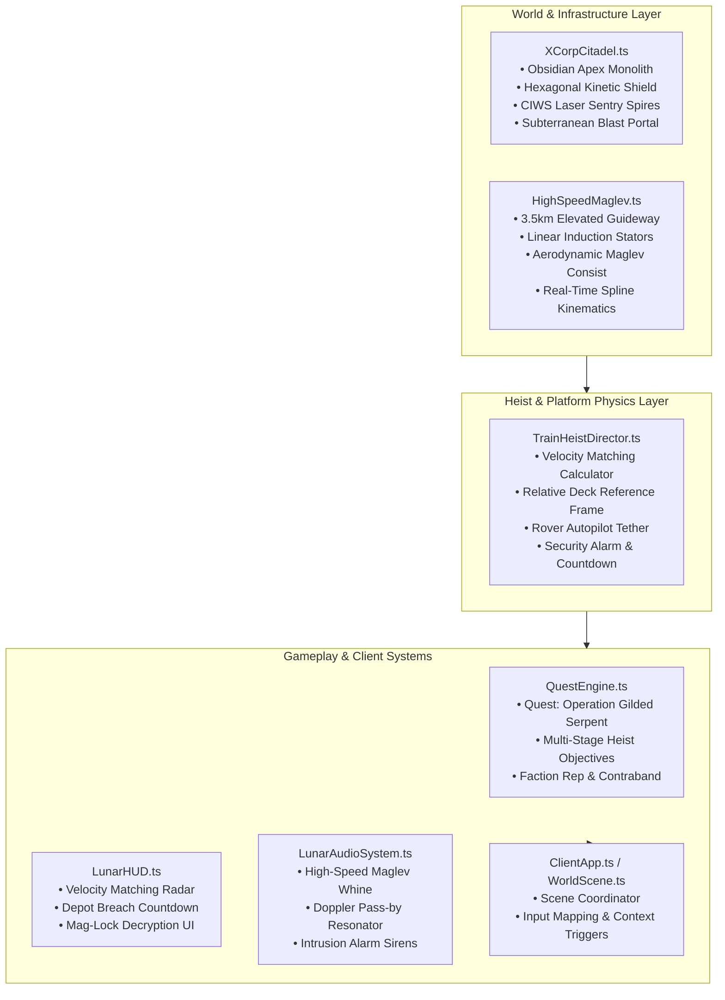
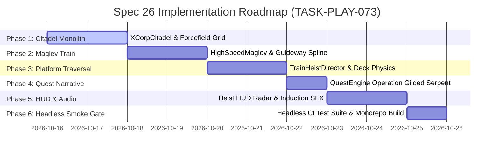

# Spec 26: Lunar Frontier — X-Corp Citadel Monolith, High-Speed Maglev Rail Hub & The Great Train Heist

> **Target Systems:** `games/lunar-frontier/src/infrastructure/XCorpCitadel.ts` (new), `games/lunar-frontier/src/infrastructure/HighSpeedMaglev.ts` (new), `games/lunar-frontier/src/quests/TrainHeistDirector.ts` (new), `games/lunar-frontier/src/engine/WorldScene.ts`, `games/lunar-frontier/src/client/ClientApp.ts`, `games/lunar-frontier/src/quests/QuestEngine.ts`, `games/lunar-frontier/src/ui/LunarHUD.ts`, `games/lunar-frontier/src/audio/LunarAudioSystem.ts`.  
> **Platforms:** WebGL2/WebGPU Desktop (Chrome/Firefox), Steam Deck & Handhelds (GPD Win Max 2, Gamepad API).  
> **Preceding Specs:** Spec 12 (Multiplayer & Economy), Spec 14 (World Infrastructure), Spec 17 (Buggy Simulation & Steering), Spec 18 (Quest Framework), Spec 19 (Gamepad & Mining UX), Spec 20/25 (Hill-Hold & Traversal Physics), Spec 21 (World Building & Rail Traffic), Spec 23 (Surface Rendering & Visor Floor), Spec 24 (Transport Arrival Experience), Spec 25 (Terrain Skirt & Procedural Web Audio).

---

## 1. Executive Summary & Narrative Context

*Lunar Frontier* features gritty nation-state survey camps, scrappy startup drill sites, and weathered derelict redoubts. However, the lunar frontier is economically dominated from the shadows by a hyper-wealthy, apex predatory megacorporation: **X-Corp (Exo-Orbital Capital & Extraction Cartel)**.

### 1.1 The Obsidian Apex: X-Corp Lunar Citadel
While independent prospectors and rival factions scrape by in rusted shipping containers and patched inflatable domes, X-Corp's lunar headquarters—**The Citadel ("The Obsidian Apex")**—is a monument to technological supremacy, extreme luxury, and unyielding corporate militarism:
- **Aesthetic:** Monolithic obsidian-black carbon composite spires, polished titanium-gold structural ribs, pristine pressurized executive penthouses with panoramic bay windows overlooking the lunar craters, illuminated heli-pads, and humming linear induction terminals.
- **Impenetrable Defense Perimeter:** Unlike other outposts, the Citadel cannot be breached by frontal rover assault or on-foot infiltration:
  - **Active Kinetic/Photonic Barrier Grid:** High-output perimeter pylons generate a shimmering hexagonal forcefield curtain ($R_\text{shield} = 220\,\text{m}$).
  - **Automated CIWS Laser Sentry Batteries:** Point-defense pulse turrets atop 35m spires track and incinerate unauthorized ground craft entering the lethal threshold ($R_\text{lethal} \le 180\,\text{m}$).
  - **Triple-Sealed Subterranean Blast Portals:** Monolithic hydraulic blast gates with zero external access interfaces; internal airlocks are biometric-locked to X-Corp executive DNA.

### 1.2 The Economic Vulnerability: High-Speed Transports
Despite its impenetrable fortress walls, X-Corp possesses an operational lifeline: its high-speed automated transport network. To consolidate refined isotopes, corporate bearer bonds, and military quantum cores from remote deep-shaft extraction facilities into the Citadel's subterranean vaults, X-Corp operates a dedicated **High-Speed Maglev Rail Line**:
- **The Apex Express ("The Gilded Serpent"):** A sleek, bullet-nosed heavy maglev train cruising across the lunar desert at $25.0\,\text{m/s}$ ($90\,\text{km/h}$) on an elevated linear induction guideway.
- **The Heist Opportunity:** The Citadel itself is impenetrable, but the freight in transit is vulnerable. Out in the rugged badlands—away from the Citadel's defensive umbrella—the train is protected only by automated security locks and its immense velocity.

### 1.3 The Core Gameplay Loop: The Great Lunar Train Heist
The player is recruited by an undercover syndicate fixer ("Zero-Six" from the RustBelt syndicate) to pull off the ultimate lunar heist:
1. **The High-Speed Intercept:** Stalk the Apex Express as it traverses the graded canyon service corridor. Match the train's cruise velocity ($25\,\text{m/s}$) in the tuned rover, pulling alongside the armored vault car within a tight lateral boarding envelope.
2. **The Speed Leap:** Trigger a high-speed leap from the driver's cockpit directly onto the speeding train's exterior catwalk while the rover locks into automated parallel tracking mode.
3. **The Vault Crack Under Countdown Pressure:** Walk the vibrating car roof in lunar vacuum, bypass the vault container's mag-locks, siphon the legendary loot (Enriched He-3 Flasks, Quantum Bearer Slates), and trigger corporate alarms.
4. **The Depot Bailout:** As the train hurtles toward the Citadel's lethal perimeter defense gate, a frantic 45-second countdown triggers. The player must leap off the train into the regolith before the transport passes into the vaporizing terminal security shield!
5. **The Badlands Escape:** Re-mount the trailing rover and evade automated pursuit drones across the craters to safely fence the stolen contraband.

---

## 2. Core Architectural Design & Component Topology



---

## 3. Detailed Subsystem Specifications

### 3.1 Feature 1: The X-Corp Citadel ("The Obsidian Apex") (`XCorpCitadel.ts`)

#### 3.1.1 Location & Spatial Layout
- Positioned in a dramatic highlands basin at world coordinates $(X = -1,850\,\text{m}, Y = 2,400\,\text{m})$.
- **Structural Composition (Procedural Babylon.js PBR Meshes):**
  1. **Central Monolith Tower:** An imposing $85\,\text{m}$ tall hexagonal skyscraper constructed from obsidian carbon-composite tiles (`metallic = 0.95`, `roughness = 0.08`, deep obsidian black `[0.02, 0.02, 0.03]`), reinforced with vertical brushed gold mullions (`[0.85, 0.68, 0.22]`).
  2. **Executive Penthouse Pods:** Cantilevered observation decks with tinted panoramic dielectric glass overlooking the lunar craters, featuring warm internal executive illumination.
  3. **Grand Maglev Terminal Viaduct:** A cavernous, illuminated rail portal penetrating the base of the mountain/monolith, where the elevated maglev guideway terminates behind armored blast gates.
  4. **Executive VIP Landing Pads:** Dual circular pads with illuminated holographic guidance chevrons and docked luxury corporate shuttles.

#### 3.1.2 The Impenetrable Defense Grid (`CitadelDefenseGrid`)
- **Outer Warning Perimeter ($R_\text{warn} = 260\,\text{m}$):**
  - Crossing this radius triggers an authoritative warning transmission on the suit comms and top HUD:
    > *"WARNING: Restrictive airspace of X-Corp Orbital Sovereign Authority. Lethal kinetic countermeasures active. Turn back immediately."*
  - Skyward beacon spotlights snap to track the player's rover.
- **Active Kinetic Forcefield Dome ($R_\text{shield} = 220\,\text{m}$):**
  - Shimmering procedural hexagonal energy curtain rendered with emissive neon-cyan fresnel edges (`Color3(0.0, 0.85, 1.0)`).
  - Physical collision boundary: Any rover or suit contact with the barrier produces a high-energy repelling impulse vector $\vec{J} = -4,500\,\text{N}\cdot\text{s} \cdot \hat{n}$ away from the center, accompanied by blue electrical arc particles and suit shield discharge audio.
- **Lethal CIWS Sentry Zone ($R_\text{lethal} = 180\,\text{m}$):**
  - Three $35\,\text{m}$ perimeter sentry spires mount rapid-traverse pulse laser turrets.
  - If an unauthorized entity crosses $R_\text{lethal}$, the turrets lock on within $1.2\,\text{s}$ and fire continuous red particle laser beams delivering fatal damage ($150\,\text{HP/s}$), ensuring the Citadel cannot be bypassed or entered from the surface.

---

### 3.2 Feature 2: High-Speed Maglev Rail System (`HighSpeedMaglev.ts`)

#### 3.2.1 Elevated Linear Induction Guideway
- Spans $3,500\,\text{m}$ connecting the **Canyon Extraction Outpost** $(X = 1,200\,\text{m}, Y = 800\,\text{m})$ through a winding basalt canyon to the **Citadel Grand Terminal** $(X = -1,850\,\text{m}, Y = 2,400\,\text{m})$.
- **Guideway Geometry:**
  - Double-track monorail guideway elevated $2.5\text{--}6.0\,\text{m}$ above the regolith surface on heavy aerodynamic concrete-composite pylons every $24\,\text{m}$.
  - Twin stator guide rails with embedded linear induction coils pulsing in sequential forward blue light chevrons.
  - A parallel graded maintenance service road running alongside the guideway at an offset of $4.0\,\text{m}$, optimized for high-speed rover interception.

#### 3.2.2 The "Apex Express" Consist Architecture
The train consist is modeled with aerodynamic low-drag vacuum styling, consisting of 4 distinct articulated cars linked by magnetic couplers:
1. **Stealth Maglev Locomotive (`apex-loco`):**
   - Streamlined wedge prow with twin forward searchlights and blue magnetic levitation skirts.
   - Sits $0.4\,\text{m}$ above the stator guideway with subtle vertical suspension bobbing ($\pm 0.04\,\text{m}$).
2. **Armored Vault Car (`apex-vault`):**
   - Heavy reinforced titanium-alloy armor plates with hazard yellow trim and illuminated corporate barcodes.
   - External maintenance catwalk with yellow safety grab rails along both flanks.
   - Roof-mounted **X-Corp Cyber-Lock Vault Container**: An interactive biometric container holding the primary heist loot.
3. **Pressurized Executive Courier Car (`apex-luxe`):**
   - Translucent carbon-glass roof section displaying a luxury interior cabin.
   - Carries auxiliary corporate encrypted data slates.
4. **Automated Drone Escort Car (`apex-escort`):**
   - Flatbed carrying inactive security surveillance drones and communications uplink antenna dish.

#### 3.2.3 Motion & Trajectory Engine
- **Speed Profile:** Cruising velocity $v_\text{cruise} = 25.0\,\text{m/s}$ ($90\,\text{km/h}$); acceleration rate $a = 2.0\,\text{m/s}^2$.
- **Guideway Spline Math:** Evaluated at 60 Hz via a uniform parametric cubic Catmull-Rom spline with arc-length parameterization $s(t)$, computing position $\vec{P}(s)$, forward tangent $\vec{T}(s)$, normal $\vec{N}(s)$, and bank angle $\phi(s)$ through curves.
- Articulation: Each trailing car evaluates its position at $s_i(t) = s(t) - i \cdot L_\text{car}$ with pitch/yaw alignment to the local track tangent.

---

### 3.3 Feature 3: Train Heist Mechanics & Platform Traversal (`TrainHeistDirector.ts`)

#### 3.3.1 Velocity Matching & The Boarding Window
To board the speeding transport safely in lunar vacuum, the player must align their rover with the moving train:

$$\Delta v = \left| \vec{v}_\text{rover} - \vec{v}_\text{train} \right| \le 3.5\,\text{m/s}$$

$$d_\text{lateral} = \left\| (\vec{P}_\text{rover} - \vec{P}_\text{vault}) - [(\vec{P}_\text{rover} - \vec{P}_\text{vault}) \cdot \hat{T}] \hat{T} \right\| \in [2.5\,\text{m},\; 5.5\,\text{m}]$$

$$d_\text{longitudinal} = \left| (\vec{P}_\text{rover} - \vec{P}_\text{vault}) \cdot \hat{T} \right| \le 3.0\,\text{m}$$

- **Matching State Indicator:** When the rover enters this spatial and velocity envelope, the HUD flashes green: `VELOCITY MATCHED // READY TO BOARD`.
- **Boarding Action:** Pressing `[E]` or Gamepad `(X)` / `(Square)` initiates the **High-Speed Jump**:
  1. The player avatar leaps from the rover cockpit across the gap onto the vault car's catwalk.
  2. The rover automatically engages **Tethered Autopilot Mode**: It maintains parallel matching speed $4.5\,\text{m}$ to the starboard side of the track, ready for the extraction bailout.

#### 3.3.2 Relative Coordinate Parenting & Deck Locomotion
- When boarded, the player character's transform is reparented to the Vault Car's local coordinate frame:
  $$\vec{P}_\text{world} = \mathbf{M}_\text{vault}(t) \cdot \vec{P}_\text{local}$$
- The player can freely walk, run, and jump on the train roof in 1/6th gravity while the train travels at $25\,\text{m/s}$ through the canyon, experiencing zero sliding or jitter.
- The camera rig switches to a dramatic high-velocity action tracking mode with subtle vibration reflecting the maglev induction pulse.

#### 3.3.3 Cracking the Vault: Decryption & Loot Siphoning
- At the vault container, the player activates the terminal to start the **Mag-Lock Bypass**:
  - A 3-stage rotating harmonic frequency alignment mini-game (or hold-to-hack terminal progress bar taking $6.0\,\text{s}$).
  - Audio: Procedural multi-frequency lock-picking chirps and hydraulic depressurization hiss.
  - The heavy magnetic clamshell lid pops open, releasing the loot payload:
    1. **$3\times$ Enriched He-3 Cryo-Flasks** (Extremely rare isotope, value: $15,000$ credits each).
    2. **$1\times$ X-Corp Quantum Cipher Slate** (Classified corporate ledger, quest item / $25,000$ fence bounty).
    3. **$2\times$ Military-Grade Superconducting Coils** (Advanced crafting / vehicle upgrade component).
- Collecting the loot immediately triggers the **Citadel Intrusion Alarm**.

#### 3.3.4 The Depot Proximity Countdown & The Leap of Faith
- Once the alarm sounds, the Citadel's terminal perimeter defense system begins tracking the incoming train:
  - **Countdown Timer:** The train is $1,100\,\text{m}$ away from the Citadel blast gates—exactly **$44.0\,\text{seconds}$** to impact/vaporization!
  - HUD flashes high-contrast red warning banners with pulsing alarm sirens:
    > `CRITICAL ALERT: DEPOT PERIMETER IMMINENT! LETHAL SHIELD BREACH IN T-30s! BAIL OUT NOW!`
- **The Bailout Jump:**
  - The player sprints to the edge of the car catwalk and executes the **Leap of Faith** (`[SPACE]` / Gamepad `(A)`).
  - Avatar launches into a low-gravity ballistic arc away from the tracks ($\vec{v}_\text{exit} = \vec{v}_\text{train} + \vec{v}_\text{lateral}$).
  - Performs a dust-kicking slide/roll landing on the regolith beside the maintenance road.
  - The Apex Express thunders ahead into the Citadel's blast tunnel, and the monolithic energy shield snaps shut behind it with an earth-shaking shockwave.
- **Extraction:**
  - The tethered rover stops smoothly nearby. The player hops back into the driver's seat and escapes into the crater badlands before automated security drones converge on the site.

---

### 3.4 Feature 4: Narrative Quest Flow ("Operation Gilded Serpent") (`QuestEngine.ts`)

| Stage | Objective Key | Narrative Comms Briefing | Success Criteria | Failure Condition |
| :--- | :--- | :--- | :--- | :--- |
| **01** | `MEET_FIXER` | Zero-Six calls via Comms Terminal: *"The Apex Express runs loaded tonight. Meet me at the canyon overlook."* | Reach canyon ridge marker $(X = 850, Y = 620)$. | - |
| **02** | `INTERCEPT_CONVOY` | *"Train is inbound on Guideway 1. Match its speed on the service road!"* | Drive alongside train; achieve $\Delta v \le 3.5\,\text{m/s}$ and $d \le 4.5\,\text{m}$. | Train reaches depot before intercept. |
| **03** | `BOARD_TRANSPORT` | *"Now! Jump while you're in the pocket!"* | Trigger board action; land on Vault Car catwalk. | Crash rover or fail jump. |
| **04** | `CRACK_VAULT` | *"Bypass the mag-locks and get the He-3 before they hit the terminal gate!"* | Complete hack and siphon loot from container. | Timer reaches 0:00 (train enters shield). |
| **05** | `LEAP_TO_SAFETY` | *"Jump off! The Citadel's defense shield will vaporize you!"* | Leap off train into regolith before lethal threshold. | Killed by terminal defense shield. |
| **06** | `DELIVER_CONTRABAND`| *"You pulled it off! Bring the haul to RustBelt Dockworks before X-Corp locks down the sector."* | Drive to RustBelt base and deliver haul to fence. | Rover destroyed by pursuit drones. |

---

### 3.5 Feature 5: Heist HUD Telemetry & Procedural Audio Design

#### 3.5.1 Heist HUD Overlay Elements (`LunarHUD.ts`, `hud.css`)
1. **High-Speed Intercept Radar:**
   - Displays relative speed delta ($\Delta v$ in $\text{m/s}$ and $\text{km/h}$), lateral distance bar, and a pulsing green targeting reticle that locks when in boarding range.
2. **Depot Breach Countdown Bar:**
   - Segmented amber-to-crimson countdown progress bar displaying remaining distance to Citadel barrier and time-to-impact ($T - \text{seconds}$).
3. **Mag-Lock Decryption Circular Dial:**
   - Holographic 3-ring alignment dial appearing in helmet visor during the vault cracking sequence.
4. **Contraband Inventory Pill:**
   - High-value glowing gold inventory slots indicating secured heist cargo.

#### 3.5.2 Procedural Web Audio Engine Additions (`LunarAudioSystem.ts`)
- **Linear Induction Guideway Hum:** Modulated carrier oscillator ($120\text{--}280\,\text{Hz}$) rising proportionally with train velocity, simulating high-power electromagnetic levitation.
- **High-Velocity Doppler Flyby:** Deep resonant whoosh and pitch shift as the $90\,\text{km/h}$ train rushes past the player's rover.
- **Mag-Lock Mechanical Disengage:** Heavy magnetic thud (sub-bass $40\,\text{Hz}$ impulse) followed by pneumatic venting noise.
- **Citadel Intrusion Klaxon:** Two-tone emergency siren ($660\,\text{Hz} \leftrightarrow 880\,\text{Hz}$) ringing through helmet suit comms during the 45s escape window.

---

## 4. Architectural Interfaces & Data Contracts

```typescript
// games/lunar-frontier/src/infrastructure/XCorpCitadel.ts

export interface CitadelOptions {
  worldCenter: { x: number; y: number; z: number };
  shieldRadiusM: number;     // Default: 220m
  lethalRadiusM: number;     // Default: 180m
  warningRadiusM: number;    // Default: 260m
}

export interface CitadelPerimeterStatus {
  distanceM: number;
  inWarningZone: boolean;
  inShieldPerimeter: boolean;
  inLethalZone: boolean;
  repulsionForceN: number;
}

export class XCorpCitadel {
  constructor(options?: Partial<CitadelOptions>);
  init(scene?: any): this;
  update(dt: number, playerPos: { x: number; y: number; z: number }): CitadelPerimeterStatus;
  getMeshes(): any[];
  dispose(): void;
}
```

```typescript
// games/lunar-frontier/src/infrastructure/HighSpeedMaglev.ts

export interface MaglevCarState {
  index: number;
  type: 'locomotive' | 'vault' | 'executive' | 'escort';
  distanceAlongSplineM: number;
  worldPosition: { x: number; y: number; z: number };
  worldForward: { x: number; y: number; z: number };
  speedMps: number;
}

export interface MaglevTrainState {
  speedMps: number;
  totalLengthM: number;
  cars: MaglevCarState[];
  distanceToDepotM: number;
  timeToDepotS: number;
}

export class HighSpeedMaglev {
  constructor(worldSnapshot?: any);
  init(scene?: any): this;
  update(dt: number): MaglevTrainState;
  getVaultCarTransform(): { position: any; rotationQuaternion: any };
  getMeshes(): any[];
  dispose(): void;
}
```

```typescript
// games/lunar-frontier/src/quests/TrainHeistDirector.ts

export type HeistPhase = 
  | 'INACTIVE'
  | 'INTERCEPTING'
  | 'BOARDING_WINDOW'
  | 'ON_BOARD_CRACKING'
  | 'LOOT_SECURED'
  | 'DEPOT_COUNTDOWN'
  | 'BAILOUT_SUCCESS'
  | 'ESCAPE_COMPLETE'
  | 'FAILED';

export interface HeistTelemetry {
  phase: HeistPhase;
  relativeSpeedMps: number;
  lateralDistanceM: number;
  longitudinalOffsetM: number;
  canBoard: boolean;
  hackProgressFraction: number;
  countdownRemainingS: number;
  stolenCargoCount: number;
}

export class TrainHeistDirector {
  constructor(maglev: HighSpeedMaglev, citadel: XCorpCitadel);
  startHeist(): void;
  update(dt: number, roverPos: any, roverVel: any, playerState: any): HeistTelemetry;
  executeBoardingJump(): boolean;
  executeBailoutJump(): boolean;
  interactVaultLock(dt: number): boolean;
  reset(): void;
}
```

---

## 5. Phased Implementation Breakdown



### Phase 1: X-Corp Citadel Monolith & Defense Perimeter (`XCorpCitadel.ts`, `WorldScene.ts`)
- Construct the procedural Obsidian Apex monolith tower, executive observation decks, and illuminated landing pads.
- Implement the procedural hexagonal forcefield curtain with emissive fresnel edges.
- Implement the multi-tier perimeter defense system (warning transmission, repulsion physics impulse, CIWS laser tracking).

### Phase 2: High-Speed Maglev Rail Guideway & Armored Consist (`HighSpeedMaglev.ts`)
- Generate the $3,500\,\text{m}$ elevated linear induction guideway spline with pylons and pulsing stator chevrons.
- Construct the 4-car aerodynamic train consist (Locomotive, Armored Vault Car, Executive Courier, Drone Escort).
- Implement the 60 Hz Catmull-Rom arc-length spline follower cruising at $25.0\,\text{m/s}$.

### Phase 3: Relative Platform Kinematics & Boarding Physics (`TrainHeistDirector.ts`, `TraversalPhysics.ts`)
- Implement the velocity-matching calculator ($\Delta v \le 3.5\,\text{m/s}$, $d_\text{lat} \in [2.5, 5.5]\,\text{m}$).
- Implement dynamic coordinate reparenting: anchor the player's walking/jumping controller to the moving vault car frame.
- Implement the tethered rover autopilot tracking state to maintain parallel pursuit during on-deck traversal.

### Phase 4: Heist Narrative Quest State Machine & Loot Tables (`QuestEngine.ts`, `TrainHeistDirector.ts`)
- Register the multi-stage narrative quest `"Operation Gilded Serpent"`.
- Implement the vault lock bypass interaction, countdown state machine, and bailout jump trajectory.
- Add legendary loot items (Enriched He-3 Flasks, Quantum Cipher Slate) and fence delivery logic at RustBelt Dockworks.

### Phase 5: High-Speed Heist HUD Telemetry, Countdown & Audio (`LunarHUD.ts`, `LunarAudioSystem.ts`)
- Build the intercept radar widget with velocity-matching lock reticle and depot breach countdown bar.
- Synthesize procedural audio: high-velocity maglev induction hum, Doppler pass-by effect, lock disengage thuds, and intrusion alarm klaxons.

### Phase 6: Headless Verification Suite, Smoke Tests & Monorepo Build Gate (`smoke-x-corp-heist.ts`)
- Stand up automated headless verification suite (`NullEngine`) verifying:
  1. Citadel geometry generation, perimeter calculations, and repulsion forces.
  2. Maglev spline evaluation, train velocity profiling, and car spacing.
  3. Velocity matching trigger criteria and relative platform coordinate transforms.
  4. Vault hacking progression, loot population, and 45s countdown triggers.
  5. Bailout ballistic kinematics and quest stage completion.
- Execute full production client build (`npm run build`).

---

## 6. Acceptance Criteria & Verification Gates

1. **Citadel Impenetrability Gate:**
   - Any approach within $R_\text{shield} = 220\,\text{m}$ without authorization repels the entity with $F \ge 4,000\,\text{N}$; crossing $R_\text{lethal} = 180\,\text{m}$ inflicts fatal damage, verifying the base cannot be breached from the exterior.
2. **Maglev Velocity & Guideway Fidelity:**
   - The Apex Express maintains continuous cruise speed ($25.0 \pm 0.5\,\text{m/s}$) along the $3,500\,\text{m}$ elevated guideway without jitter or car detachment.
3. **Boarding Window Precision:**
   - The boarding prompt triggers strictly when relative velocity $\Delta v \le 3.5\,\text{m/s}$ and lateral distance is within $2.5\text{--}5.5\,\text{m}$.
4. **Moving Platform Traversal:**
   - Once boarded, the avatar walks and jumps on the moving car deck without sliding backwards or slipping off due to world velocity.
5. **Countdown & Bailout Integrity:**
   - Siphoning the vault starts the depot countdown; leaping off before $T = 0$ safely deposits the player in regolith near their tethered rover, while failing to leap before depot entry results in perimeter vaporization.
6. **Zero-Asset Procedural Audio:**
   - All audio elements (induction hum, klaxons, locks, Doppler) are synthesized via native Web Audio API with zero external media files.
7. **Headless CI Verification:**
   - `npx tsx scripts/smoke-x-corp-heist.ts` runs cleanly on `NullEngine` with 100% assertions passing. Production bundle `npm run build` succeeds with zero errors.
