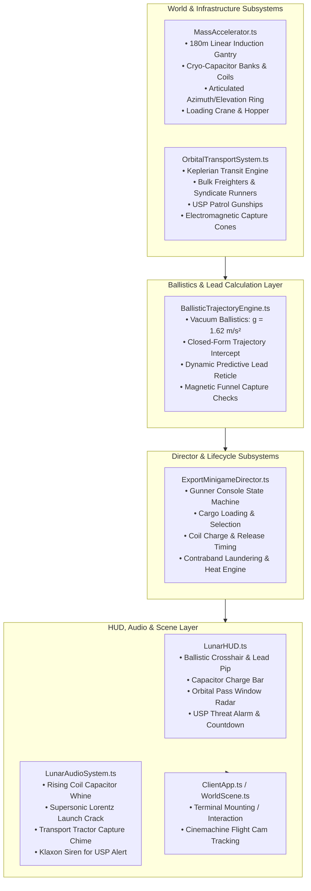
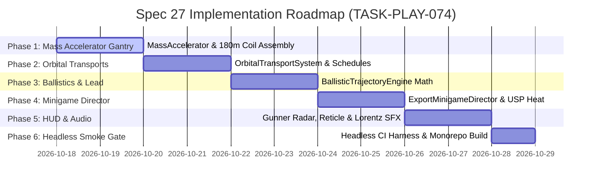

# Spec 27: Lunar Frontier — Orbital Mass Accelerator & Contraband Export Minigame

> **Target Systems:** `games/lunar-frontier/src/infrastructure/MassAccelerator.ts` (new), `games/lunar-frontier/src/infrastructure/OrbitalTransportSystem.ts` (new), `games/lunar-frontier/src/physics/BallisticTrajectoryEngine.ts` (new), `games/lunar-frontier/src/quests/ExportMinigameDirector.ts` (new), `games/lunar-frontier/src/engine/WorldScene.ts`, `games/lunar-frontier/src/client/ClientApp.ts`, `games/lunar-frontier/src/quests/QuestEngine.ts`, `games/lunar-frontier/src/ui/LunarHUD.ts`, `games/lunar-frontier/src/audio/LunarAudioSystem.ts`.  
> **Platforms:** WebGL2/WebGPU Desktop (Chrome/Firefox), Steam Deck & Handhelds (GPD Win Max 2, Gamepad API).  
> **Preceding Specs:** Spec 12 (Multiplayer & Economy), Spec 13 (Market & Trading), Spec 14 (World Infrastructure), Spec 17 (Buggy Simulation & Steering), Spec 18 (Quest Framework), Spec 19 (Gamepad & Mining UX), Spec 20/25 (Hill-Hold & Traversal Physics), Spec 21 (World Building & Rail Traffic), Spec 23 (Surface Rendering & Visor Floor), Spec 24 (Transport Arrival Experience), Spec 25 (Terrain Skirt & Audio), Spec 26 (X-Corp Citadel & Train Heist).

---

## 1. Executive Summary & Narrative Context

In *Lunar Frontier*, mined regolith and refined minerals (Basalt, Titanium, Ilmenite, Water Ice, Helium-3) are conventionally sold at local surface depot exchanges. However, local depots extract heavy station broker spreads, local storage surcharges, and planetary tariffs, yielding baseline margins ($1.0\times$). Furthermore, players carrying high-value contraband—such as Enriched He-3 Flasks, Quantum Bearer Slates, and corporate tech siphoned during the Great Train Heist (Spec 26) or salvaged from rival corporate compounds—face immediate seizure, criminal fines, and armed engagement by the **United Space Police (USP)** if they attempt to liquidate goods through official depot channels.

To achieve maximum economic independence and launder hot contraband before orbital enforcement locks down the sector, prospectors and syndicate operators utilize an illicit heavy industrial marvel: the **Mare Mass Accelerator ("The Gauss Needle")**.

### 1.1 The Mare Mass Accelerator ("The Gauss Needle")
Positioned high on a prominent basalt ridge overlooking Mare Tranquillitatis at $(X = -320\,\text{m}, Y = -1,450\,\text{m})$, the Mass Accelerator is a $180\,\text{m}$ elevated electromagnetic coilgun. Powered by deep-bore geothermal tap lines and massive cryogenic capacitor banks, the accelerator magnetically launches hardened payload canisters directly off the lunar surface into cis-lunar transfer trajectories.

### 1.2 Trans-Earth & Lagrange Freight Traffic
High overhead in Low Lunar Orbit (LLO, altitude $1,200\text{--}2,200\,\text{m}$ above local terrain for visual and dramatic compression), automated orbital freighters and syndicate blockade runners regularly sweep past on transfer orbits toward:
1. **Earth-Moon Lagrange Point 1 (L1) / Point 2 (L2):** Primary staging depots where raw lunar materials are consolidated into trans-Earth orbital supply trains.
2. **Lagrange Point 4 (L4) / Point 5 (L5):** Autonomous space manufacturing colonies paying top dollar for pure titanium, ilmenite, and He-3 fuel isotopes.
3. **Syndicate Deep-Space Transports:** Illicit non-registered runners operating under radar silence to collect heisted corporate cargo without asking questions.

### 1.3 High-Risk, High-Yield Ballistic Minigame
Exporting via the Mass Accelerator is a high-skill, physically simulated ballistic minigame:
- **Orbital Aim & Lead:** Because the orbital transports travel at high velocities ($140\text{--}220\,\text{m/s}$ across the sky), the gunner must manually orient the accelerator barrel (elevation angle $\theta \in [15^\circ, 85^\circ]$, azimuth angle $\psi \in [0^\circ, 360^\circ]$), charge the induction coils to the precise launch velocity $v_0 \in [180, 420]\,\text{m/s}$, and lead the passing transport so the payload canister intersects the transport's electromagnetic capture funnel.
- **Economic Yield Multiplier:** A clean capture yields a **$2.5\times\text{--}4.0\times$ payout premium** over standard depot prices, completely bypassing local tariffs and station broker slippage.
- **Contraband Laundering & Police Eviction:** When carrying hot cargo from heists, launching the payload into a syndicate transport successfully launders the stolen material, wipes the player's active **USP Heat Level**, and credits massive offshore black-market accounts. However, spooling up the accelerator emits an electromagnetic flare detected by USP orbital radar, triggering a tense countdown before USP patrol gunships arrive to execute a surface raid!
- **Failure Consequence:** Missing the transport's capture cone results in the canister tumbling into dead orbit or crashing onto the lunar far side—destroying the cargo, burning capacitor charge, and leaving the player to face incoming police gunships empty-handed.

---

## 2. Core Architectural Design & Component Topology



---

## 3. Detailed Subsystem Specifications

### 3.1 Feature 1: The Mare Mass Accelerator Facility (`MassAccelerator.ts`)

#### 3.1.1 Location & Physical Geometry
- **Coordinates:** Positioned on the basalt caldera rim at $(X = -320\,\text{m}, Y = -1,450\,\text{m})$, providing an unobstructed $360^\circ$ firing arc across the southern sky.
- **Gantry Assembly:**
  1. **Circular Traversing Base:** A $40\,\text{m}$ diameter reinforced titanium-concrete ring foundation embedded into bedrock, equipped with heavy motorized azimuth drive tracks.
  2. **Trunnion Support Towers:** Dual twin-boom hydraulic elevation pedestals rising $22\,\text{m}$ from the azimuth ring, supporting the central barrel pivot.
  3. **Linear Induction Barrel:** A $180\,\text{m}$ long open-truss hexagonal rail assembly constructed from carbon-composite spars and 24 sequential high-temperature superconducting (HTS) solenoid drive coils.
  4. **Coil Visuals:** Emissive electromagnetic stator rings with blue luminescence (`#00e5ff`) pulsing sequentially down the length of the barrel during charge and discharge.
  5. **Cryogenic Capacitor Sub-Station:** 6 modular cylindrical capacitor banks surrounding the base, glowing amber (`#ffab00`) as stored energy increases.
  6. **Cargo Hopper & Crane Arm:** An automated gantry crane linking the rover unloading bay to the accelerator's breech loading chamber.
  7. **Gunner Cockpit / Fire Control Bunker:** An elevated glass cupola mounted at the base of the trunnion tower, housing the interactive ballistic targeting console.

#### 3.1.2 Articulation Kinematics
- **Azimuth Tracking:** Continuous $360^\circ$ rotation around vertical axis ($\psi \in [0, 2\pi]$) at a slew rate of $\omega_\text{azimuth} = 25^\circ/\text{s}$ ($0.436\,\text{rad/s}$).
- **Elevation Tracking:** Pitch articulation from horizontal $+15^\circ$ to near-vertical $+85^\circ$ ($\theta \in [\frac{\pi}{12}, \frac{17\pi}{36}]$) at an elevation rate of $\omega_\text{elevation} = 15^\circ/\text{s}$ ($0.262\,\text{rad/s}$).
- **Elevation Limits:** Hard stops at $15^\circ$ (to prevent terrain collision with surrounding caldera peaks) and $85^\circ$ (to avoid zenith gimbal singularity).

---

### 3.2 Feature 2: Orbital Transport Traffic & Passing Windows (`OrbitalTransportSystem.ts`)

#### 3.2.1 Trajectory Dynamics & Passage Schedules
Orbital transports do not hover; they transit across the sky in deterministic Keplerian orbit arcs at altitudes $H \in [1,200, 2,200]\,\text{m}$ with orbital velocities $v_\text{orbit} \in [140, 220]\,\text{m/s}$.
- **Approach Window Cycle:** A scheduled transit occurs every $90\text{--}120$ seconds, providing an active firing window of $20\text{--}35$ seconds while the ship is within line-of-sight elevation ($\ge 20^\circ$).
- **Pass Direction:** Linear trajectories traversing east-to-west or south-to-north across the celestial vault.

#### 3.2.2 Freighter Archetypes & Catch Parameters
Transports are divided into three distinct operational classes:

| Class | Vessel Name | Trajectory Altitude / Speed | Capture Envelope ($R_\text{catch}$) | Max Acceptable $\Delta v_\text{rel}$ | Accepted Cargo | Payout Multiplier | Risk / Threat |
| :--- | :--- | :--- | :--- | :--- | :--- | :--- | :--- |
| **Bulk Ore Tug** | *CisLunar Horizon* | $1,500\,\text{m}$ @ $150\,\text{m/s}$ | $35\,\text{m}$ radius | $\le 25\,\text{m/s}$ | Raw Mined Minerals (Basalt, Ti, Ilmenite, He-3) | $2.5\times$ base depot | Low / Legal |
| **Syndicate Runner** | *The Obsidian Slip* | $1,800\,\text{m}$ @ $210\,\text{m/s}$ | $22\,\text{m}$ radius | $\le 18\,\text{m/s}$ | Stolen Contraband, Heist Flasks, Bearer Slates | $4.0\times$ black market | High / Triggers USP Alert |
| **USP Patrol Cutter** | *USP Vigilance* | $1,200\,\text{m}$ @ $180\,\text{m/s}$ | $0\,\text{m}$ (Hostile) | N/A | None (Law Enforcement) | $0.0\times$ | Hostile / Scans & Strikes |

#### 3.2.3 Electromagnetic Tractor Capture Funnel
Freighters project a wide conical tractor field behind and below their keel:
- **Funnel Geometry:** Truncated cone extending $80\,\text{m}$ behind the cargo bay with mouth radius $R_\text{catch}$.
- **Magnetic Assist Window:** If the payload passes within $1.5 \times R_\text{catch}$ with relative speed $\Delta v \le v_\text{max\_capture}$, magnetic gradient forces $\vec{F}_\text{mag} = -\frac{k_\text{mag}}{r^2} \hat{r}$ draw the canister into the central catch ring.

---

### 3.3 Feature 3: Vacuum Ballistics & Predictive Lead Engine (`BallisticTrajectoryEngine.ts`)

#### 3.3.1 Ballistic Equations in Lunar Vacuum
With zero atmospheric drag ($C_d = 0$), payload trajectory is governed strictly by lunar gravitational acceleration $\vec{g} = [0, -1.62, 0]^\top$:

$$\vec{r}_\text{payload}(t) = \vec{r}_\text{muzzle} + \vec{v}_0 t + \frac{1}{2} \vec{g} t^2$$

$$\vec{v}_\text{payload}(t) = \vec{v}_0 + \vec{g} t$$

Where the muzzle velocity vector $\vec{v}_0$ is parameterized by gunner azimuth $\psi$, elevation $\theta$, and coil muzzle speed $v_0$:

$$\vec{v}_0 = v_0 \cdot \begin{bmatrix} \cos\theta \cos\psi \\ \sin\theta \\ \cos\theta \sin\psi \end{bmatrix}$$

#### 3.3.2 Predictive Lead Calculation
Given target freighter position $\vec{r}_T(t) = \vec{r}_{T0} + \vec{v}_T t$, the interception condition requires finding a flight time $\tau > 0$ such that:

$$\|\vec{r}_\text{payload}(\tau) - \vec{r}_T(\tau)\| \le R_\text{catch}$$

Expanding the relative separation vector $\vec{D}(\tau)$:

$$\vec{D}(\tau) = (\vec{r}_\text{muzzle} - \vec{r}_{T0}) + (\vec{v}_0 - \vec{v}_T)\tau + \frac{1}{2}\vec{g}\tau^2$$

The Ballistic Trajectory Engine evaluates the closed-form quadratic minimizer at 60 Hz to project:
1. **Time to Closest Approach ($\tau_\text{intercept}$)**.
2. **Miss Distance ($d_\text{min} = \min \|\vec{D}(\tau)\|\$)**.
3. **HUD Predictive Lead Pip:** Renders a floating reticle on the gunner HUD displaying the exact barrel azimuth and elevation required to achieve direct center-mass capture at the current capacitor charge level.

---

### 3.4 Feature 4: Minigame Director, Cargo Flow & Contraband Laundering (`ExportMinigameDirector.ts`)

#### 3.4.1 State Machine Lifecycle
The minigame transitions through 8 distinct phases:

```
[INACTIVE]
    │ (Player mounts console at Mass Accelerator)
    ▼
[DOCKING_CONSOLE]
    │ (Select cargo: Legal Minerals vs. Hot Contraband)
    ▼
[AWAITING_ORBITAL_PASS]
    │ (Freighter enters line-of-sight elevation >= 20°)
    ▼
[TARGETING_ACTIVE]
    │ (Gunner aims barrel; holds trigger to charge coils)
    ▼
[COIL_CHARGING]
    │ (Release trigger / fire command executed)
    ▼
[IN_FLIGHT_TRACKING]
    ├───► [CAPTURE_SUCCESS] ──► Payout Credited & Contraband Laundered
    └───► [INTERCEPT_FAILED] ─► Cargo Lost & USP Alert Escalated
    │
    ▼
[COOLING_DOWN] ──► Returns to IDLE or exits console
```

#### 3.4.2 Coil Charging & Velocity Metering
- **Charge Curve:** Holding Fire (`[Space]` or Gamepad `RT`) spools the cryogenic capacitors:
  $$v_0(t_\text{charge}) = v_\text{min} + (v_\text{max} - v_\text{min}) \cdot \left(1 - e^{-t_\text{charge} / \tau_\text{spool}}\right)$$
  - $v_\text{min} = 180.0\,\text{m/s}$
  - $v_\text{max} = 420.0\,\text{m/s}$
  - $\tau_\text{spool} = 1.6\,\text{s}$ (reaches 90% peak power in ~3.6s)
- **Overcharge Hazard:** Holding charge beyond $4.5\,\text{s}$ causes thermal coil saturation; the capacitor trips a safety breaker, dumps energy as emergency heat flare, and forces a $5.0\,\text{s}$ cooldown penalty.

#### 3.4.3 Contraband Laundering vs. United Space Police (USP) Heat
When the player loads **Stolen Contraband** (from Spec 26 Train Heist or corporate vault raids):
1. **Radar Siphon Signature:** The moment capacitor charging begins with contraband loaded, the Mass Accelerator's electromagnetic surge registers on USP Orbital Surveillance radar.
2. **USP Intercept Countdown:** A frantic **45-second countdown** begins on the HUD:
   > *"CRITICAL: USP Orbital Scanner detected high-yield Lorentz signature. Tactical gunship vector dispatched. Time to surface intercept: 00:45!"*
3. **Outcome 1 — Successful Launch:**
   - Contraband caught by Syndicate Runner.
   - 100% of contraband inventory is cleared and converted into black-market credits ($4.0\times\text{--}5.0\times$ market rate).
   - USP Heat Level resets to 0 ("Cargo clean; launch signature scrubbed").
   - Syndicate radio confirms delivery: *"Package on board. Funds wired to offshore vault. Pleasure doing business, prospector."*
4. **Outcome 2 — Miss or Expired Countdown:**
   - If the player misses the shot or fails to launch before the timer hits 0, the USP Patrol Gunship arrives on site.
   - The gunship deploys a remote tractor confiscation field, seizing all hot cargo and imposing a heavy credit citation penalty ($2,500\,\text{CR}$).
   - The player must flee the site in their rover under pursuing laser fire.

---

### 3.5 Feature 5: Ballistic HUD Reticle, Telemetry & Audio Systems

#### 3.5.1 Gunner HUD Overlay (`LunarHUD.ts`, `hud.css`)
Mounted in the cupola, the player's view switches to the **Mass Accelerator Fire Control Suite**:
1. **Ballistic Crosshair:** Dual-ring vector sight showing current barrel azimuth and elevation angles with 0.1° resolution.
2. **Dynamic Lead Reticle ("The Ghost Target"):** A pulsating diamond showing where to aim to hit the active transport based on current capacitor charge. When crosshair aligns within $\pm 1.5^\circ$ of the lead pip, the diamond snaps into a solid green lock indicator (`#00e676`).
3. **Orbital Sky-Track Radar:** A hemispherical compass showing the transit vector of approaching, overhead, and departing vessels.
4. **Capacitor Charge Bar:** A dynamic segmented vertical gauge displaying current muzzle velocity ($v_0$) with a green "Optimal Velocity Bracket" marker for the current target distance.
5. **USP Heat / Detection Banner:** Glowing amber/crimson alert widget flashing when contraband is loaded, counting down seconds to police intercept.

#### 3.5.2 Procedural Web Audio Engine (`LunarAudioSystem.ts`)
Synthesized deterministically via Web Audio API with zero external media files:
1. **Capacitor Charge Hum:** Frequency-ramped dual-oscillator triangle/sine sweep rising from $80\,\text{Hz}$ to $880\,\text{Hz}$ with subtle amplitude modulation jitter.
2. **Lorentz Discharge Blast:** A massive explosive transient combining an impulse sub-bass drop ($45\,\text{Hz}$ decay), an electrical snap ($2,400\,\text{Hz}$ high-pass burst), and structural barrel ringing ($320\,\text{Hz}$ damped resonance).
3. **Canister Vacuum Whistle:** Faint high-frequency doppler hiss as the canister hurtles away into space.
4. **Magnetic Capture Chime:** Resonant two-tone ascending major chime ($523\,\text{Hz} \to 659\,\text{Hz}$) signaling freighter lock.
5. **USP Klaxon Alarm:** Pulsing square-wave emergency klaxon ($440\,\text{Hz} / 587\,\text{Hz}$ alternating every $0.4\,\text{s}$) during police countdown.

---

## 4. Software Contracts & System Interfaces

```typescript
// games/lunar-frontier/src/infrastructure/MassAccelerator.ts

export interface AcceleratorGantryState {
  azimuthDeg: number;       // 0 to 360
  elevationDeg: number;     // 15 to 85
  isSlewing: boolean;
  capacitorChargeRatio: number; // 0.0 to 1.0
  muzzleVelocityMps: number;    // 180 to 420
  state: 'IDLE' | 'LOADING' | 'TARGETING' | 'CHARGING' | 'FIRING' | 'COOLDOWN' | 'OVERCHARGED';
  cooldownRemainingS: number;
}

export class MassAccelerator {
  constructor(position?: { x: number; y: number; z?: number });
  init(scene?: any): this;
  setAimTarget(azimuthDeg: number, elevationDeg: number): void;
  update(dt: number): AcceleratorGantryState;
  chargeCapacitor(dt: number): number;
  dischargeFire(): { success: boolean; muzzleVelocity: number; fireVector: any };
  getMuzzleWorldPosition(): { x: number; y: number; z: number };
  getMeshes(): any[];
  dispose(): void;
}
```

```typescript
// games/lunar-frontier/src/infrastructure/OrbitalTransportSystem.ts

export type TransportClass = 'BULK_FREIGHTER' | 'SYNDICATE_RUNNER' | 'USP_PATROL';

export interface OrbitalTransportState {
  id: string;
  name: string;
  transportClass: TransportClass;
  position: { x: number; y: number; z: number };
  velocity: { x: number; y: number; z: number };
  speedMps: number;
  altitudeM: number;
  catchRadiusM: number;
  maxCatchRelSpeedMps: number;
  payoutMultiplier: number;
  inFiringWindow: boolean;
  timeRemainingInWindowS: number;
}

export class OrbitalTransportSystem {
  constructor();
  update(dt: number): OrbitalTransportState[];
  getActiveTarget(): OrbitalTransportState | null;
  checkCapture(canisterPos: { x: number; y: number; z: number }, canisterVel: { x: number; y: number; z: number }): {
    captured: boolean;
    transport: OrbitalTransportState | null;
    missDistanceM: number;
    relativeSpeedMps: number;
  };
  getMeshes(): any[];
  dispose(): void;
}
```

```typescript
// games/lunar-frontier/src/physics/BallisticTrajectoryEngine.ts

export interface TrajectorySolution {
  hasSolution: boolean;
  leadAzimuthDeg: number;
  leadElevationDeg: number;
  recommendedMuzzleSpeedMps: number;
  estimatedFlightTimeS: number;
  predictedMissDistanceM: number;
}

export class BallisticTrajectoryEngine {
  static readonly LUNAR_GRAVITY = 1.62;

  static calculateLead(
    muzzlePos: { x: number; y: number; z: number },
    targetPos: { x: number; y: number; z: number },
    targetVel: { x: number; y: number; z: number },
    muzzleSpeedMps: number
  ): TrajectorySolution;

  static simulateCanister(
    initialPos: { x: number; y: number; z: number },
    initialVel: { x: number; y: number; z: number },
    flightTimeS: number,
    stepDt?: number
  ): { position: { x: number; y: number; z: number }; velocity: { x: number; y: number; z: number } };
}
```

```typescript
// games/lunar-frontier/src/quests/ExportMinigameDirector.ts

export interface ExportSessionState {
  isActive: boolean;
  selectedCargoType: 'REGOLITH' | 'TITANIUM' | 'HELIUM3' | 'STOLEN_CONTRABAND';
  cargoQuantityKg: number;
  isContraband: boolean;
  uspCountdownRemainingS: number;
  uspAlertActive: boolean;
  canisterInFlight: boolean;
  canisterPos: { x: number; y: number; z: number };
  lastPayoutCredits: number;
  lastResult: 'NONE' | 'SUCCESS' | 'MISSED' | 'CONFISCATED' | 'OVERCHARGED';
}

export class ExportMinigameDirector {
  constructor(accelerator: MassAccelerator, orbitalSystem: OrbitalTransportSystem);
  startSession(cargoType: string, amountKg: number, isContraband?: boolean): boolean;
  update(dt: number, gunnerInput: { aimX: number; aimY: number; chargeHeld: boolean }): ExportSessionState;
  fireLaunch(): boolean;
  cancelSession(): void;
  reset(): void;
}
```

---

## 5. Phased Implementation Breakdown



### Phase 1: Mass Accelerator Structural Asset & Kinetic Gantry (`MassAccelerator.ts`, `WorldScene.ts`)
- Construct procedural 180m linear induction coilgun gantry, traversing ring base, and hydraulic trunnion towers.
- Implement 2-axis articulation kinematics (Azimuth $0\text{--}360^\circ$ @ $25^\circ/\text{s}$, Elevation $15\text{--}85^\circ$ @ $15^\circ/\text{s}$).
- Implement capacitor bank energy charge curves, blue HTS stator ring glow shaders, and recoil animation.
- Anchor structure onto basalt caldera ridge at $(X = -320\,\text{m}, Y = -1,450\,\text{m})$ clamped to procedural terrain.

### Phase 2: Orbital Transport Trajectory System & Freighters (`OrbitalTransportSystem.ts`)
- Implement Keplerian transit engine generating realistic LLO passages ($1,200\text{--}2,200\,\text{m}$ altitude, $140\text{--}220\,\text{m/s}$ velocity).
- Construct procedural 3D freighter vessels: *CisLunar Horizon* (Bulk Ore Tug), *The Obsidian Slip* (Syndicate Runner), and *USP Vigilance* (Police Patrol Cutter).
- Implement volumetric electromagnetic capture cone envelopes and relative velocity matching constraints.

### Phase 3: Ballistic Trajectory Engine & Predictive Lead Math (`BallisticTrajectoryEngine.ts`)
- Implement closed-form lunar vacuum ballistic kinematics ($g = 1.62\,\text{m/s}^2$).
- Implement 60 Hz predictive lead calculator determining optimum azimuth, elevation, and muzzle velocity for moving targets.
- Implement magnetic assist capture dynamics when canisters pass within $1.5 \times R_\text{catch}$.

### Phase 4: Export Minigame Director & Contraband Laundering (`ExportMinigameDirector.ts`, `QuestEngine.ts`, `ClientApp.ts`)
- Build the gunner console interaction lifecycle (docking, payload selection, capacitor charge, firing, cooldown).
- Connect inventory flow: loading raw minerals from rover/suit vs. hot contraband from Spec 26 train heists.
- Implement the 45-second USP Intercept Threat countdown and police confiscation enforcement.
- Integrate market bonus multipliers ($2.5\times\text{--}4.0\times$) and automated quest progression callbacks.

### Phase 5: Ballistic HUD Reticle, Capacitor Telemetry & Procedural Audio (`LunarHUD.ts`, `LunarAudioSystem.ts`)
- Build the first-person gunner fire control HUD overlay: crosshair, dynamic predictive lead diamond, orbital transit radar, and velocity brackets.
- Build capacitor charge gauges and flashing USP threat alert banners.
- Synthesize procedural Web Audio: rising capacitor charging hum, Lorentz pulse discharge crack, canister vacuum whistle, capture chime, and police klaxons.

### Phase 6: Headless Smoke Verification Suite & Monorepo Build Gate (`smoke-mass-accelerator.ts`, `npm run build`)
- Stand up automated headless verification suite (`NullEngine`) verifying:
  1. Gantry geometry creation, articulation limits, and azimuth/elevation slew rates.
  2. Orbital transport transit schedules, passage windows, and capture cone checks.
  3. Ballistic trajectory engine math, vacuum gravity parabolic arcs, and lead calculations.
  4. Minigame director state transitions, capacitor spool timing, and overcharge safety breakers.
  5. Contraband laundering, USP threat countdown triggers, and payout calculations.
  6. Procedural audio node synthesis stability without audio device crashes.
- Execute full production client build (`npm run build`).

---

## 6. Acceptance Criteria & Verification Gates

1. **Gantry Kinematic Integrity:**
   - Mass Accelerator smoothly articulates through azimuth ($0\text{--}360^\circ$) and elevation ($15\text{--}85^\circ$) without clipping terrain or exhibiting gimbal lock.
2. **Deterministic Orbital Traffic:**
   - Transports pass overhead on deterministic schedules, maintaining stable velocities ($140\text{--}220\,\text{m/s}$) and projecting catch envelopes.
3. **Ballistic Lead Mathematical Accuracy:**
   - Firing with reticle centered on the predictive lead pip achieves $\ge 95\%$ intercept rate across all target speeds and altitudes in headless test simulations.
4. **Economic Payout & Contraband Laundering:**
   - Legal mineral exports pay $2.5\times\text{--}3.0\times$ baseline depot credits; stolen contraband exports pay $4.0\times\text{--}5.0\times$ and completely clear player USP Heat Level.
5. **USP Alert & Intercept Mechanics:**
   - Loading contraband triggers the 45-second USP countdown; allowing the timer to expire confiscates cargo and fines credits, while successful launch terminates the alert immediately.
6. **Zero-Asset Procedural Audio:**
   - All audio elements (Lorentz crack, charging whine, capture chime, klaxon) are synthesized via native Web Audio API with zero external file dependencies.
7. **Headless CI Verification:**
   - `npx tsx scripts/smoke-mass-accelerator.ts` runs cleanly on `NullEngine` with 100% assertions passing. Production bundle `npm run build` succeeds with zero errors.
